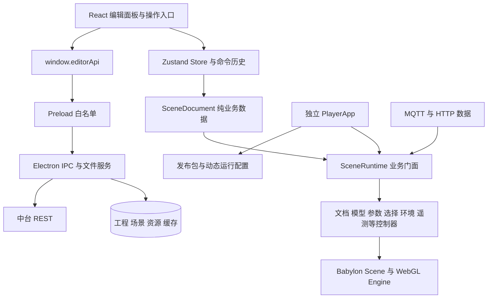
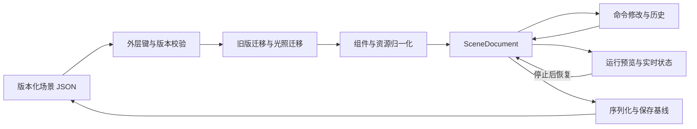

# babylon-3d-plus：三维编辑器与 Viewer 技术架构

[返回总览](README.md) · [跨项目契约](03-integration-contracts.md) · [运行与维护](04-operations-and-risks.md)

本文依据 2026-10-27 至 2026-10-28 当前工作树静态阅读。版本来自声明与锁文件，不是本次安装验证结果。以下源码链接均相对于本文最终所在的项目 `docs/technical-handover/`。

## 产品形态与技术栈

项目包名为 `zending-3d-editor`，产品名为 `ZENDING 3D EDITOR`，版本 0.4.5。它同时构建 Electron 桌面编辑器和独立 Web Viewer。桌面具备本地文件系统、资源同步、MQTT 主进程代理、Blender 烘焙和工程发布能力；Viewer 复用场景运行时，在浏览器读取发布包和项目运行配置。直接在浏览器打开编辑器 Vite 页面不能获得完整桌面功能。

| 层次 | 当前声明或锁定版本 | 作用 |
| --- | --- | --- |
| UI 与状态 | React / React DOM 19.2.7，Zustand 5.0.14 | 编辑界面、状态与操作编排 |
| 三维 | Babylon core/loaders/serializers 9.12.0 | WebGL 场景、模型、材质和交互 |
| 桌面 | Electron 42.4.0，electron-builder 26.15.3 | 主进程、IPC、协议与 Windows 安装包 |
| 构建 | Vite 8.0.16，TypeScript 6.0.3 | 编辑器、Viewer 和主进程编译 |
| 实时数据 | MQTT.js 5.15.1 | MQTT over WS/WSS |
| CAD | `@linkiez/dxf-renew` 7.4.5 | DXF 参考图 |
| 验证 | Node test runner、Playwright 1.61.1、自定义脚本 | 单元、集成、GPU 与发布专项验证入口 |
| 环境要求 | Node `^22.15.0 || >=24.0.0` | 以 package engines 为准 |
| 外部烘焙 | Blender 4+ / Cycles | 需要独立安装，不随 npm 自动满足 |

依据：[package.json](../../package.json#L188)、[锁文件](../../package-lock.json)、[烘焙引擎配置](../../electron/ipc/lightingBakeEngineConfiguration.ts#L15)。中台管理端使用另一套 React/Babylon 依赖，不能把两仓版本视为一致。

## 入口与分层

桌面主进程入口为 `electron/main.ts`，负责窗口、IPC、本地资源协议和退出清理。窗口实际加载编译后的 `preload.cjs`；preload 将白名单能力放在 `window.editorApi`，renderer 不直接获得 Node 文件系统。窗口配置采用 `contextIsolation:true`、`nodeIntegration:false`。敏感操作还要检查 IPC sender，不能仅凭 UI 按钮禁用来保证操作边界。

编辑器入口为 `index.html → src/main.tsx → App.tsx`。当前不是常规多路由 SPA：`App` 主要切换 home/editor，两种开发查询参数用于演示场景。中台深链接 `zending3d://open-project` 在初次启动、第二实例和系统 open-url 事件中处理。Viewer 入口独立位于 `src/player/main.tsx`，其页面并非编辑器的只读模式。

依据：[主进程](../../electron/main.ts#L176)、[preload](../../electron/preload.cts#L70)、[React 入口](../../src/main.tsx#L57)、[App 切换](../../src/App.tsx#L14)、[Viewer 入口](../../src/player/main.tsx)、[桌面能力检查](../../src/editor/home/HomePage.tsx#L76)。

| 源码区域 | 维护职责 |
| --- | --- |
| `electron/`、`electron/ipc/` | 主进程、文件导入保存、平台同步、发布、MQTT、烘焙 |
| `electron/shared/` | 场景版本、资源引用、发布及跨进程契约 |
| `src/editor/model/` | 实体、组件、场景配置、默认值及归一化 |
| `src/editor/store/`、`commands/` | 状态切片、编辑操作、撤销重做、保存基线 |
| `src/editor/panels/`、`layout/`、`ui/` | 层级、属性、资源、场景视图及对话框 |
| `src/editor/assets/` | 资源刷新、重关联、场景模型版本更新事务 |
| `src/editor/deployment/` | 导出发布 UI、准备、快照、冲突与进度 |
| `src/runtime/babylon/` | Babylon 运行时与模型脚本执行 |
| `src/runtime/mqtt/`、`effects/` | 设备遥测、消息适配、特效数据 |
| `src/runtime/roam/`、`patrol/`、`opening/` | 漫游、巡检、开场动画 |
| `src/player/` | 浏览器启动、宿主桥、运行配置、发布缓存 |
| `src/standalone-opening/` | 独立开场 SDK，不是主应用入口 |
| `scripts/`、`tests/` | 构建、发布检查、专项测试与夹具 |

`Assets/`、`Platforms/`、`SharedResources/`、`.babylon-editor/` 属于工作数据、资产或缓存体系，不应作为普通应用源码处理。状态组合入口见 [editorStore.ts](../../src/editor/store/editorStore.ts#L14)，独立开场 SDK 见 [index.ts](../../src/standalone-opening/index.ts#L8)。

## 场景模型、编辑事务与保存

当前场景外层版本为 7，读取支持 1 至 7。外层包含 `version`、米制 `units` 和 `scene`。`SceneDocument` 保存场景 ID/名称、实体顺序及实体映射、选中实体、MQTT 配置、场景设置和 Fetch 配置；`Entity` 保存父子关系、显示/锁定等属性与组件。组件是工业物流业务表达的基础，涉及模型、CAD、阵列、生成器、库位、灯光、天空、特效、大屏、巡检、出生点与点击事件。

这不是 Babylon 原生 `.babylon` 文件，也不是旧 Babylon Editor `project.bjseditor`。不要直接将中台业务场景 GLB 或旧工程导入包交给该序列化器。迁移依次进行，不是 `JSON.parse` 后无检查使用。

依据：[场景版本](../../electron/shared/sceneFileVersion.ts#L1)、[实体](../../src/editor/model/Entity.ts#L4)、[SceneDocument](../../src/editor/model/SceneDocument.ts#L1084)、[组件](../../src/editor/model/components.ts#L14)、[序列化](../../src/editor/project/SceneSerializer.ts#L111)、[迁移](../../src/editor/project/sceneMigration.ts#L78)。

撤销重做采用命令模式，历史上限 200。未保存状态由序列化内容与保存基线比较，不以历史栈长度为依据。高频变换预览另有 token 和场景会话校验，避免旧拖拽在切换场景后回写。运行预览期间限制部分编辑和保存操作；停止预览恢复设备模型基线并释放运行时货物，设计状态与实时状态应分开理解。

普通场景保存通过主进程系统对话框取得路径，随后直接写入 JSON；该路径不是完整的临时文件加原子替换设计。现有返回首页/切换入口有未保存确认，但所有窗口关闭路径是否同等保护仍需实测。

依据：[CommandHistory](../../src/editor/commands/CommandHistory.ts#L18)、[保存比较](../../src/editor/project/SceneSerializer.ts#L125)、[变换预览](../../src/editor/store/transformPreviewStore.ts#L40)、[预览退出恢复](../../src/runtime/babylon/scene-runtime/SceneTelemetryController.ts#L234)、[保存 IPC](../../electron/ipc/projectIpc.ts#L183)。

## 模型与资源加载

场景视图建立 WebGL Engine、Scene、ArcRotateCamera、编辑网格和相机控制，再启动渲染循环；不是 WebGPU 默认管线。编辑器和 Viewer 对硬件 GPU 有检查，软件渲染只在明确开发逃生配置下使用。Viewer 可保持后台渲染，不应假定页面不可见即完全不占 GPU。

`SceneRuntime` 是统一业务门面，向文档、模型、参数、选择、环境、特效、光照、货物、遥测等控制器分派。排查一个实体异常时，应先判断是 SceneDocument、资产解析、模型加载、参数应用还是运行遥测的问题，而不是直接在渲染循环里打补丁。

依据：[createEngine.ts](../../src/runtime/babylon/createEngine.ts#L156)、[SceneRuntime](../../src/runtime/babylon/SceneRuntime.ts#L99)、[Viewer 视口配置](../../src/player/PlayerApp.tsx#L663)。

模型导入扫描主文件、`meta.json`、脚本、贴图和单位，形成资源条目与模型组件。运行时通过加载调度器和共享模型缓存进入 glTF loader，完成层级挂接、单位缩放、参数和脚本启动。普通主模型支持 `.glb/.gltf`，多主文件歧义必须处理；缺省单位按米，不靠尺寸参数猜测。默认加载并发为 4。

异步模型加载带 token、signature 和 AbortController；切场景或换模型后的迟到结果应被销毁。取消排队不代表底层已开始的解码可以立即取消，部分加载会自然结束后释放容器。查看 loading 不结束或内存异常，应沿这一生命周期定位。

依据：[包扫描器](../../electron/ipc/modelPackageScanner.ts#L659)、[glTF 加载器](../../src/runtime/babylon/babylonGltfLoader.ts#L1)、[调度器](../../src/runtime/babylon/AssetLoadScheduler.ts#L1)、[模型控制器](../../src/runtime/babylon/scene-runtime/ModelAssetRuntimeController.ts#L189)。

缓存不是所有模型统一 thin instance。普通静态模型可共享模板；有参数或脚本的模型通常隔离容器以避免顶点修改污染；明确声明 `shared-readonly` 几何的模型可以采取共享只读策略。缓存身份考虑平台、资源、路径和修订/哈希，默认空闲缓存预算 16 项、128 MiB。阵列、生成货物和动态设备另有实例池及专用优化。

依据：[SharedModelAssetCache](../../src/runtime/babylon/SharedModelAssetCache.ts#L44)。

### 外置模型脚本的信任边界

模型 TS 脚本从资源读取，使用预转译缓存或懒加载 TypeScript 转译，最终以 `new Function` 执行。脚本通过参数、资产编号、运行模式与遥测驱动模型，包含 `onStart/onUpdate/onStop` 生命周期。它属于可信模型代码扩展，不是中台 GraalJS 那样限制主机能力的独立沙箱；内容哈希只能校验一致性，不能证明来源安全。

部署 CSP 必须与实际执行方式一致，但不能为了可运行就把任意第三方模型包视为可信。应把脚本审核和模型来源管理纳入发布流程。依据：[ExternalModelScriptRuntime](../../src/runtime/babylon/ExternalModelScriptRuntime.ts#L401)、[导出部署提示](../../electron/ipc/deploymentExportScene.ts#L1341)。

## 工业物流运行能力

设备运行以 `sourceId/deviceType/assetCode` 标识关联数据，驱动器覆盖堆垛机、输送线、RGV、穿梭车、提升机等设备，并管理货物、运动箭头、故障和断流行为。模型显示正常不代表遥测绑定正确；Broker 连通也不代表字段映射、运动单位或资产编号正确。

库位/货物 Fetch 是场景配置的 HTTP 接口，发送 `{rows}`，预期 `data.records[].result[]` 中有容器及库位信息。特效 HTTP 则走数据源代理或 MQTT 最新值接口；这两种 Fetch 链并不相同，详细结构见[跨项目契约](03-integration-contracts.md)。

依据：[设备类型与适配器](../../src/runtime/mqtt/deviceTelemetry.ts#L42)、[专用遥测驱动](../../src/runtime/babylon/telemetry/specialized/SpecializedTelemetryRuntime.ts#L19)、[库位请求](../../src/runtime/babylon/scene-runtime/SceneLocatorFetchController.ts#L350)、[特效数据运行时](../../src/runtime/effects/EffectDataRuntime.ts#L52)。

场景交互包括拾取、多选、分组、锁定隐藏、变换 gizmo、吸附和设备点击。CAD 为 DXF 参考图，大文件需要 Worker，不能将失败后主线程解析视作安全通用回退。巡检支持路线、停留、事件、截图、历史和回放，记录主要在 IndexedDB；默认 reporter 为 null，不能宣称已有固定后台巡检上报。漫游具有人物、输入、出生点和碰撞代理。大屏/特效还包含 HTTP/MQTT 绑定，不只是视觉材质。

依据：[拾取处理](../../src/editor/panels/scene-view/useSceneSelectionHandlers.ts#L79)、[巡检存储](../../src/runtime/patrol/AutoPatrolInspectionRecordStore.ts#L189)、[巡检回放](../../src/runtime/babylon/AutoPatrolPlaybackController.ts#L267)、[漫游](../../src/runtime/roam/ManualRoamRuntime.ts#L222)。

## 光照、天空和资源释放

HDR/EXR 天空准备为运行资源，和普通模型有独立校验、同步和缓存。光照包含实时/静态/混合阴影、烘焙间接光与探针；烘焙由 Electron 启动本机 Blender，结果匹配当前几何/光照签名后才提交，失败保留旧结果。实验优化不是默认性能保证，尤其不要为排查问题一次性打开全部动静合批、稀疏更新或 GI batching 开关。

依据：[烘焙服务](../../electron/ipc/lightingBakeService.ts#L246)、[光照运行时](../../src/runtime/babylon/SceneLightingRuntime.ts#L388)。

Scene View 卸载会解除事件、MQTT、漫游、巡检、gizmo 和性能监控，再销毁运行时与视口。`SceneRuntime.dispose()` 封闭异步写入、停止帧更新、恢复预览并释放业务实例和共享缓存。Viewer 启动失败与卸载、Electron 退出也有清理链。存在这些代码不等于已证明长时间运行无泄漏，仍需大场景、反复切换和失败取消测试。

依据：[Scene View 清理](../../src/editor/panels/SceneViewPanel.tsx#L1440)、[Runtime.dispose](../../src/runtime/babylon/SceneRuntime.ts#L689)、[Viewer 清理](../../src/player/PlayerApp.tsx#L1120)、[应用退出](../../electron/main.ts#L309)。

## 本地工程、同步与持久化

| 位置或机制 | 内容 | 维护边界 |
| --- | --- | --- |
| Electron userData | 最近工程、平台配置、烘焙配置、脚本缓存 | 配置并非全部加密；safeStorage 不等于全工程保密 |
| `.babylon-editor/` | 资产索引、平台绑定、同步/恢复元数据 | 不要当可无条件删除的临时目录 |
| `Platforms/{sourceKey}/Projects/{projectId}` | 来源隔离的中台本地工程 | 相同 projectId 在不同平台不是同一工程 |
| `SharedResources` | 共享资源库 | 最新库资源和场景固定版本不同 |
| `Conflicts/{projectId}/…` | 远端恢复冲突副本 | 清理前先确认其中是否有未保留的本地编辑 |
| 浏览器 IndexedDB | 发布缓存、天空缓存、巡检记录等 | 浏览器清站点数据会影响本地记录；不是服务端备份 |

依据：[工程定位](../../electron/ipc/dataPlatformProjectLocation.ts#L23)、[平台绑定](../../electron/ipc/dataPlatformBindingStore.ts#L14)、[冲突恢复](../../electron/ipc/dataPlatformProjectService.ts#L1143)、[发布缓存](../../src/runtime/assets/publishedCacheStore.ts#L3)。

平台工程打开会定位来源隔离目录、恢复 SOURCE、重定位资源引用、同步和重关联模型。资源库更新不能直接等同替换场景模型，存在固定版本与同步事务；发生冲突时保留副本。这也是不能随意删除 Assets、SharedResources 和元数据后只留一个场景文件的原因。

## 导出与测试入口

普通 Web 导出将当前场景和依赖资源变成静态目录/ZIP；数字孪生发布增加目标预检、资源快照、SOURCE/DIST 双包、分片、版本冲突与提交。普通导出 runtime-config 为 v1，数字孪生 DIST 为 v2；两条链的凭据清理策略不相同，详见维护风险。

`build` 构建 TypeScript、编辑器和 Viewer；`build:viewer` 以 `src/player` 为 root，产出 `dist-viewer-template`。Windows 打包显式面向 x64/NSIS。`typecheck` 会执行 project build、补主进程产物和复制脚本，不能视为完全只读检查。`test` 与 `test:ci` 默认只覆盖 core 分组，而不是所有设备、CAD、烘焙、GPU 和安装包测试。

依据：[Viewer 配置](../../vite.viewer.config.ts#L40)、[构建脚本](../../scripts/build-typescript.mjs#L55)、[默认测试分组](../../scripts/test-groups.mjs#L7)、[CI](../../.github/workflows/ci.yml#L15)、[打包配置](../../package.json#L228)。本次所有构建、测试与 GPU 行为均未运行验证。
