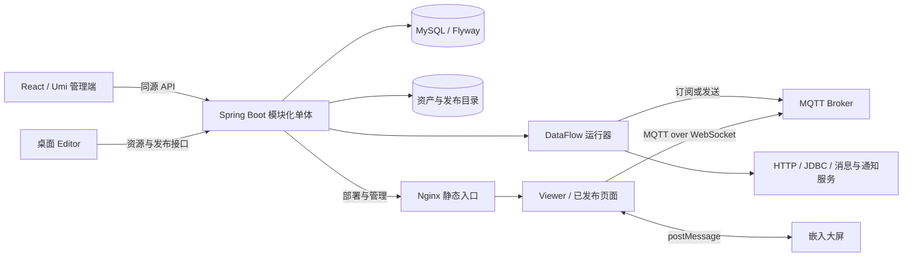
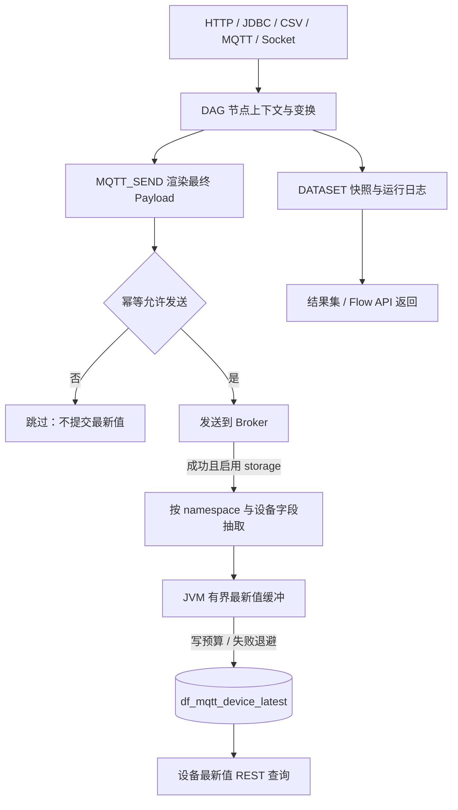

# central-data-platform 技术交接

[返回总览](README.md) · [跨项目契约](03-integration-contracts.md) · [运行与维护](04-operations-and-risks.md)

## 阅读口径与系统定位

本章依据 **2026-10-27 至 2026-10-28 的静态阅读与整理**，说明中台的实现结构、状态归属和接手边界。没有安装依赖、执行构建或测试、启动服务、运行迁移，也没有连接数据库、Broker、摄像头或外部接口。文中的实现事实不等于部署已启用，风险判断不等于故障已复现；配置默认值不等于生产生效值。

研究对象是存在大量工作树差异的代码目录，**不是某次提交的可复现快照**。源码行号对应阅读时工作树，后续修改可能使锚点漂移。本章不携带任何凭据，不枚举全量接口；跨项目请求字段和消息主契约另见相邻章节。源码链接按本组位于 `babylon-3d-plus/docs/technical-handover/`、两仓库为同级目录编排。

中台是“数字孪生资源管理、数据编排、大屏设计与发布、桌面 Editor 集成”的模块化单体。Maven 聚合 19 个模块，由一个 Spring Boot 主程序装入同一应用，不是微服务集群，也不是专门面向浏览器的实时消息网关。模块边界主要是代码和业务责任边界，并不天然提供进程隔离或独立扩容能力。依据见 [聚合 POM:14–34](../../../central-data-platform/backend/pom.xml#L14-L34)、[启动模块依赖:16–129](../../../central-data-platform/backend/twin-admin-start/pom.xml#L16-L129) 与 [应用入口:13–20](../../../central-data-platform/backend/twin-admin-start/src/main/java/com/centraldataplatform/twin/TwinAdminApplication.java#L13-L20)。

## 技术栈与模块责任

### 依赖与运行基础

下表描述源码声明或依赖用途，不代表本机安装版本或已经验证的兼容组合。前端同时保留 npm 与 yarn 锁文件，接手构建前应确定唯一安装口径；不能以一次成功安装反推全部历史环境一致。

| 层次 | 当前技术选择 | 交接解释 |
| --- | --- | --- |
| 后端基础 | Java 17、Spring Boot 3.5.9、Spring MVC / Validation | 单一 JVM 承载管理、文件与编排能力 |
| 数据访问 | MyBatis-Plus 3.5.12、MySQL、Flyway | 实际表结构以迁移及目标库核对为准 |
| 编排执行 | Quartz、GraalVM Polyglot / JS Community 25.0.3 | 定时触发与用户脚本均在服务端执行 |
| 外部通道 | Paho MQTT v3 1.2.5、RabbitMQ Java Client、JavaMail | 客户端依赖不代表外部服务已配置 |
| 管理前端 | React 18、Umi Max 4、Ant Design 5 | 非 Vue；页面、路由与请求封装由 Umi 组织 |
| 编辑与呈现 | X6、Babylon.js、ECharts、Monaco、HLS | 分别承担流程画布、三维、图表、脚本和媒体能力 |

后端版本证据见 [根 POM:36–81](../../../central-data-platform/backend/pom.xml#L36-L81)，数据流依赖见 [模块 POM:16–54](../../../central-data-platform/backend/twin-module-dataflow/pom.xml#L16-L54)，前端依赖见 [package.json:1–41](../../../central-data-platform/frontend/package.json#L1-L41)。MySQL 驱动、Flyway 等未在对应依赖处逐项固定版本，不能在未解析依赖树时补写传递版本。

### 公共层与业务层

`twin-admin-start` 负责启动、配置、Flyway 和 Logback；`twin-common-core` 定义跨域异常与资源生命周期契约；`twin-common-web` 统一响应、异常、CORS 与 Long 序列化；`twin-common-mybatis` 提供实体基类和分页。基类中的 `createdBy/updatedBy/deleted` 标为 `exist=false`，不能据此宣称全局自动审计或逻辑删除已经生效。见 [BaseEntity:14–30](../../../central-data-platform/backend/twin-common-mybatis/src/main/java/com/centraldataplatform/twin/common/mybatis/BaseEntity.java#L14-L30)。

`twin-common-storage` 提供本地/内存文件存储及日志适配；`twin-common-security` 当前主要提供下载票据，而非完整 JWT/RBAC 框架。应用显式排除 Redis 自动配置，静态研究未发现实际 Redis 缓存链路，需求文档中的 Redis、Spring Security 等规划不能直接算作现有能力。见 [application.yml:19–24](../../../central-data-platform/backend/twin-admin-start/src/main/resources/application.yml#L19-L24) 与 [FileDownloadTokenService:16–46](../../../central-data-platform/backend/twin-common-security/src/main/java/com/centraldataplatform/twin/common/security/FileDownloadTokenService.java#L16-L46)。

资源域由 project、scene、model、env-model、combo-model、screen、skybox、file 分担；system 管理品牌、菜单、国际化、Nginx 和日志；dataflow 负责采集、运行、发送和结果；editor、publish、integration 则连接桌面工程、发布历史与外部资源聚合。排查问题应沿 Controller → 应用服务 → Mapper/存储/外部调用追踪，不宜只看模块名称判断事务或权限边界。模块装配依据见 [启动 POM:40–129](../../../central-data-platform/backend/twin-admin-start/pom.xml#L40-L129)。

## 架构与管理前端

图中区分了控制面、文件面与实时通道：中台通过 REST 管理资源和发布，通过 DataFlow 连接外部系统；Viewer 的 MQTT over WebSocket 是直连 Broker，不是把数据流订阅转换成中台 WebSocket。静态研究没有发现后端 WebSocket/SSE 服务实现，不应承诺中台提供浏览器订阅、ACK 或断点续传。服务端接收正向证据见 [DataFlowMqttSubscribeService:123–180](../../../central-data-platform/backend/twin-module-dataflow/src/main/java/com/centraldataplatform/twin/dataflow/run/app/service/DataFlowMqttSubscribeService.java#L123-L180)；客户端与嵌入消息细节由[跨项目契约](03-integration-contracts.md)承接。

管理前端使用 hash 路由，生产请求走同源 `/api`；开发 `API_TARGET` 仅用于代理，并限定本机候选端口，不是可随意配置任意生产后端域名的通用开关。页面覆盖项目资源、大屏、发布中心、DataFlow 设计与日志、设备最新值和系统设置。阅读入口是 [config.ts:1–48](../../../central-data-platform/frontend/config/config.ts#L1-L48)、[routes.ts:1–194](../../../central-data-platform/frontend/config/routes.ts#L1-L194) 和 [app.tsx:325–437](../../../central-data-platform/frontend/src/app.tsx#L325-L437)。

当前登录页面直接进入工作台，初始化状态不建立完整用户权限模型。嵌入场景的请求虽然能够附加宿主 Bearer，但这不代表后端已验证该身份，更不代表菜单隐藏构成授权。见 [Login/index.tsx:119–136](../../../central-data-platform/frontend/src/pages/Login/index.tsx#L119-L136) 与 [app.tsx:97–125、418–437](../../../central-data-platform/frontend/src/app.tsx#L97-L125)。

前端维护必须保留字符串 ID 约定，不能先 `Number(id)` 再转字符串；大整数精度一旦丢失无法恢复。后端全局将 `Long/long` 序列化为字符串，分页计数也受影响。普通 JSON 接口、二进制下载、代理原始响应与运行结果不能共享“永远取 data 就成功”的判断。依据见 [longId.ts:1–31](../../../central-data-platform/frontend/src/services/longId.ts#L1-L31)、[JacksonLongToStringConfig:16–26](../../../central-data-platform/backend/twin-common-web/src/main/java/com/centraldataplatform/twin/common/web/JacksonLongToStringConfig.java#L16-L26) 与 [GlobalExceptionHandler:32–120](../../../central-data-platform/backend/twin-common-web/src/main/java/com/centraldataplatform/twin/common/web/GlobalExceptionHandler.java#L32-L120)。

## 数据库与资源关系

### 迁移是结构演进的依据

应用启动扫描 `classpath:db/migration`，阅读时迁移文本覆盖 V1 至 V90；没有连接目标数据库确认已执行版本。`backend/sql/schema/001_base_schema.sql` 是参考整合草案，不能替代 Flyway，更不能把其中的用户、角色、部门表视为已经打通的认证体系。见 [Flyway 配置:22–24](../../../central-data-platform/backend/twin-admin-start/src/main/resources/application.yml#L22-L24)、[V1:1–31](../../../central-data-platform/backend/twin-admin-start/src/main/resources/db/migration/V1__baseline_mysql8.sql#L1-L31) 与 [V90:1–31](../../../central-data-platform/backend/twin-admin-start/src/main/resources/db/migration/V90__screen_i18n.sql#L1-L31)。

| 数据族 | 主要表或关系 | 状态与恢复含义 |
| --- | --- | --- |
| 项目与资源 | `dt_project`、五类项目资源关系、场景模型/屏幕关系 | 关联不等于独占拥有，模型允许共享 |
| 模型与环境 | `dt_model/version`、`dt_env_model`、`dt_combo_model`、`model_device_type` | 文件版本、业务编码和环境运行修订需要分别保留 |
| 大屏与语言 | `dt_screen/publish/clone_batch`、`sys_i18n_*` | 草稿、发布快照、翻译目录是不同状态 |
| 文件与视频 | `dt_file/content`、`dt_video`、`dt_skybox` | 数据库登记不能替代磁盘资产备份 |
| Editor 与发布 | `dt_editor_*`、`dt_asset*`、`dt_project_publish`、`dt_digital_twin_*` | 工程、资源快照、上传任务与部署目录共同组成发布链 |
| 数据流 | `df_flow/node/edge`、数据源、数据集、调度、日志、幂等、最新值表 | 草稿、发布版、执行历史与设备状态互不等价 |

关系表与数据流基础结构见 [V2:1–43](../../../central-data-platform/backend/twin-admin-start/src/main/resources/db/migration/V2__project_config_relations.sql#L1-L43)、[V11:1–76](../../../central-data-platform/backend/twin-admin-start/src/main/resources/db/migration/V11__editor_project_assets.sql#L1-L76)、[V22:1–166](../../../central-data-platform/backend/twin-admin-start/src/main/resources/db/migration/V22__dataflow_visual_app.sql#L1-L166)；文件副本与发布扩展见 [V63:1](../../../central-data-platform/backend/twin-admin-start/src/main/resources/db/migration/V63__file_image_database_content.sql#L1) 和 [V67:1–129](../../../central-data-platform/backend/twin-admin-start/src/main/resources/db/migration/V67__digital_twin_publish_integration.sql#L1-L129)。

数据库并非“完全没有外键”。共享模型关系已有 RESTRICT，项目发布、数字孪生上传和环境组合也存在外键，业务服务同时执行引用检查。删除行为必须结合目标库实际约束判断，不能由某个 Service 的单条 delete 推导全库清理结果。见 [V64:17–65](../../../central-data-platform/backend/twin-admin-start/src/main/resources/db/migration/V64__shared_model_reference_constraints.sql#L17-L65) 与 [V89:5–25](../../../central-data-platform/backend/twin-admin-start/src/main/resources/db/migration/V89__editable_environment_compositions.sql#L5-L25)。

### 共享、绑定与待发布修订

三类模型可被多个项目共享，大屏直接归属最多一个项目。项目绑定场景会补齐场景使用的模型；场景新增模型绑定也会补齐所属项目关系，反向解绑却不会自动移除项目模型。因此关系数量增长不一定是脏数据，删除前应先区分显式项目绑定和场景使用。见 [ProjectAppService:417–448、560–587](../../../central-data-platform/backend/twin-module-project/src/main/java/com/centraldataplatform/twin/project/app/service/ProjectAppService.java#L417-L448) 与 [SceneModelBindingAppService:27–38](../../../central-data-platform/backend/twin-module-scene/src/main/java/com/centraldataplatform/twin/scene/app/service/SceneModelBindingAppService.java#L27-L38)。

统一 `config/save` 使用资源 ID 做差量，普通解绑则使用关系 ID，两者不能混用。统一保存会先验证最终场景集合和模型使用，再在事务中写入；单类绑定与解绑合计最多 1000，全量最多 5000。三类模型删除先检查引用，任一资源受阻会拒绝该批次。关键实现见 [ProjectConfigSaveAppService:62–120、187–229](../../../central-data-platform/backend/twin-module-project/src/main/java/com/centraldataplatform/twin/project/app/service/ProjectConfigSaveAppService.java#L62-L120)。

共享资源正常更新会向直接引用项目记 dirty 并递增修订。发布捕获修订，完成时只清理不晚于该修订的变化，从而保留发布期间的新修改；这不是对文件和部署目录的全局事务。独立按名称/编号导入直接写 Mapper 的链路未统一接入 dirty 服务，可能覆盖资源却没有待发布提示。依据见 [ProjectResourceRevisionAppService:61–129、214–239](../../../central-data-platform/backend/twin-module-project/src/main/java/com/centraldataplatform/twin/project/app/service/ProjectResourceRevisionAppService.java#L61-L129) 与 [ModelNameTransferImportService:57–103](../../../central-data-platform/backend/twin-module-model/src/main/java/com/centraldataplatform/twin/model/app/service/ModelNameTransferImportService.java#L57-L103)。

## 模型、环境与发布语义

普通模型以唯一 `modelCode` 标识，主文件、JSON 元数据、多份 TS 脚本和版本记录共同组成资源；更新脚本会整组替换，文件变化与纯元数据更新的版本行为不同。上传接受并不等于完成三维内容解析：模型层允许的 FBX/OBJ 与通用文件层白名单还不一致，`parseStatus=SUCCESS` 不能作为可加载性证明。见 [ModelAppService:192–255、771–908](../../../central-data-platform/backend/twin-module-model/src/main/java/com/centraldataplatform/twin/model/app/service/ModelAppService.java#L192-L255)、[格式检查:1566–1576](../../../central-data-platform/backend/twin-module-model/src/main/java/com/centraldataplatform/twin/model/app/service/ModelAppService.java#L1566-L1576) 与 [FileAppService:74–80](../../../central-data-platform/backend/twin-module-file/src/main/java/com/centraldataplatform/twin/file/app/service/FileAppService.java#L74-L80)。

环境模型强调自包含 GLB、权威 SHA-256、单位以及文件/运行修订。替换文件产生新文件修订，修改单位影响运行修订；同步清单返回实际 manifestRevision，但不会按客户端指定旧修订冻结跨页视图，客户端发现修订变化必须重新同步。GLB 的 HEAD 和小 Range 也会先全文件校验，具有整文件 I/O 成本。见 [EnvModelAppService:227–329](../../../central-data-platform/backend/twin-module-env-model/src/main/java/com/centraldataplatform/twin/envmodel/app/service/EnvModelAppService.java#L227-L329)、[EnvModelSyncManifestService:35–72](../../../central-data-platform/backend/twin-module-env-model/src/main/java/com/centraldataplatform/twin/envmodel/app/service/EnvModelSyncManifestService.java#L35-L72) 与 [EnvModelGlbFileService:101–139](../../../central-data-platform/backend/twin-module-env-model/src/main/java/com/centraldataplatform/twin/envmodel/app/service/EnvModelGlbFileService.java#L101-L139)。

环境组合属于 `dt_env_model.model_kind=COMPOSITION`，带包清单、成员层级、历史 revision 和 operationId 幂等；更新需 baseRevision 匹配。它不是 `dt_combo_model` 的简单组合资源。后者可只有元数据，普通 update 不替换 GLB；其独立迁移 ZIP 仅恢复元数据和缩略图，不含主 GLB，不能作为完整备份。见 [EnvCompositionService:58–88](../../../central-data-platform/backend/twin-module-env-model/src/main/java/com/centraldataplatform/twin/envmodel/app/service/EnvCompositionService.java#L58-L88)、[ComboModelAppService:238–277](../../../central-data-platform/backend/twin-module-combo-model/src/main/java/com/centraldataplatform/twin/combomodel/app/service/ComboModelAppService.java#L238-L277) 与 [ComboModelTransferAppService:149–186](../../../central-data-platform/backend/twin-module-combo-model/src/main/java/com/centraldataplatform/twin/combomodel/app/service/ComboModelTransferAppService.java#L149-L186)。

项目发布需要区分普通 RESOURCE、旧 Editor、新 DIGITAL_TWIN 三条链。普通资源发布冻结 metadata/URL，不构建 Viewer，也不复制全部文件；旧 Editor 的工程版本激活与 Nginx 部署分开；新数字孪生发布经历 prepare、分片上传、complete、commit，再形成工程版本、部署目录、统一发布记录与项目绑定。见 [PublishAppService:137–182](../../../central-data-platform/backend/twin-module-publish/src/main/java/com/centraldataplatform/twin/publish/app/service/PublishAppService.java#L137-L182)、[EditorAppService:621–684](../../../central-data-platform/backend/twin-module-editor/src/main/java/com/centraldataplatform/twin/editor/app/service/EditorAppService.java#L621-L684) 与 [DigitalTwinPublishAppService:116–320](../../../central-data-platform/backend/twin-module-editor/src/main/java/com/centraldataplatform/twin/editor/app/service/DigitalTwinPublishAppService.java#L116-L320)。

新发布支持恢复、回滚和下线，但部署文件系统与数据库并无全局事务；静态部署先于最后的统一发布/绑定完成，后续失败可能留下短暂不一致。服务内 `synchronized` 也只覆盖本 JVM。运维应分别核对数据库发布记录、稳定地址、历史 release 与文件存在性，不能仅凭一次 commit 的 HTTP 层成功确认所有层面一致。见 [DigitalTwinPublishAppService:203–320、365–451](../../../central-data-platform/backend/twin-module-editor/src/main/java/com/centraldataplatform/twin/editor/app/service/DigitalTwinPublishAppService.java#L203-L320)。

## DataFlow：采集与 DAG 执行

### 输入能力与实际限制

HTTP 数据源支持 GET/POST、参数替换和 NONE/BEARER/HEADER 配置；MYSQL/POSTGRESQL 通过 JDBC 查询，CSV 读取本地文件。EXCEL/WEBHOOK 当前只是返回空数组和启用提示，不应作为已交付的解析或接收能力。JDBC 的语句前缀检查与只读标记不是数据库权限隔离，CSV 按逗号拆分也不是完整 RFC CSV 解析。见 [DataSourceAppService:457–583](../../../central-data-platform/backend/twin-module-dataflow/src/main/java/com/centraldataplatform/twin/dataflow/datasource/app/service/DataSourceAppService.java#L457-L583)。

HTTP 默认超时 15 秒、响应限额 1 MiB，但客户端先读完整 `byte[]` 再检查大小；普通流程采集路径不会仅因非 2xx 就自动失败，错误 JSON 仍可能进入下游。独立 GET 分支可以启用受限并发，循环和接收事件执行不走该并发路径。接手时应显式设计状态码和业务错误判断，而非把节点未抛异常等同于上游业务成功。见 [JdkDataSourceHttpClient:16–47](../../../central-data-platform/backend/twin-module-dataflow/src/main/java/com/centraldataplatform/twin/dataflow/datasource/app/service/JdkDataSourceHttpClient.java#L16-L47)、[DataSourceAppService:568–641](../../../central-data-platform/backend/twin-module-dataflow/src/main/java/com/centraldataplatform/twin/dataflow/datasource/app/service/DataSourceAppService.java#L568-L641) 与 [DataFlowRunService:819–984](../../../central-data-platform/backend/twin-module-dataflow/src/main/java/com/centraldataplatform/twin/dataflow/run/app/service/DataFlowRunService.java#L819-L984)。

数据源详情会脱敏，迁移导出却有意保留恢复运行所需的原配置。发布快照冻结 DAG/configJson，不冻结被 dataSourceId 引用的数据源实体，修改数据源仍可改变已发布流程的实际请求。因此“发布版本固定”只适用于流程定义，不能推导外部依赖和认证配置也固定。见 [DataSourceAppService:225–245、852–871](../../../central-data-platform/backend/twin-module-dataflow/src/main/java/com/centraldataplatform/twin/dataflow/datasource/app/service/DataSourceAppService.java#L852-L871) 与 [DataFlowPublishService:250–265](../../../central-data-platform/backend/twin-module-dataflow/src/main/java/com/centraldataplatform/twin/dataflow/flow/app/service/DataFlowPublishService.java#L250-L265)。

### 拓扑、版本和事务

校验要求恰好一个 START、END、DATASET，所有节点位于 START→END 的连通路径，禁止拓扑环；多入边只允许 MERGE/JOIN/CUSTOM_JS。FOREACH/LOOP_END 是结构化循环，不是普通回边。PREVIEW/INTERVAL 虽在允许枚举中，却没有独立执行分支，真正定时触发来自调度表。见 [DataFlowValidationService:54–224](../../../central-data-platform/backend/twin-module-dataflow/src/main/java/com/centraldataplatform/twin/dataflow/flow/app/service/DataFlowValidationService.java#L54-L224) 与 [DataFlowRunService:553–799](../../../central-data-platform/backend/twin-module-dataflow/src/main/java/com/centraldataplatform/twin/dataflow/run/app/service/DataFlowRunService.java#L553-L799)。

运行上下文按 nodeKey 保存各节点响应与 rows，CONDITION 将记录分配到 IF/ELSE 边，未命中分支跳过。发送节点返回的是一条统计结果而非透传原始业务行；把 DATASET 放在发送节点之后，保存内容就可能是发送统计而非采集数据。见 [DataFlowRunService:579–787](../../../central-data-platform/backend/twin-module-dataflow/src/main/java/com/centraldataplatform/twin/dataflow/run/app/service/DataFlowRunService.java#L579-L787) 与 [DataFlowSendService:187–221](../../../central-data-platform/backend/twin-module-dataflow/src/main/java/com/centraldataplatform/twin/dataflow/run/app/service/DataFlowSendService.java#L187-L221)。

手动运行默认使用草稿，调度使用当前 PUBLISHED，外部 HTTP API 强制当前 PUBLISHED；显式 publishId 可选择本流程历史版本。`rerun(logId)` 只取 flowId，以 RERUN 执行当前草稿，不携带原运行参数或历史发布版本，**不是历史重放**。回滚把目标历史记录切换为当前发布，不新增版本；复制到草稿则不切换发布版。见 [DataFlowRunService:399–408、1184–1277](../../../central-data-platform/backend/twin-module-dataflow/src/main/java/com/centraldataplatform/twin/dataflow/run/app/service/DataFlowRunService.java#L399-L408) 与 [DataFlowPublishService:163–205](../../../central-data-platform/backend/twin-module-dataflow/src/main/java/com/centraldataplatform/twin/dataflow/flow/app/service/DataFlowPublishService.java#L163-L205)。

执行先独立事务写 RUNNING，再加载和校验拓扑；无循环成功路径与有循环路径的事务包围不同，循环外部调用在最终结果提交事务之外，发送服务也排除调用方事务。下游失败无法撤回已经发送的外部消息。多数运行异常转换为内层 `status=FAILED`，外层 `ApiResult.success` 仍可为 true。见 [DataFlowRunService:302–389、470–519](../../../central-data-platform/backend/twin-module-dataflow/src/main/java/com/centraldataplatform/twin/dataflow/run/app/service/DataFlowRunService.java#L302-L389) 与 [DataFlowSendService:159–168](../../../central-data-platform/backend/twin-module-dataflow/src/main/java/com/centraldataplatform/twin/dataflow/run/app/service/DataFlowSendService.java#L159-L168)。

### 调度、互斥与停止

普通执行通过 JVM 内 flow 互斥防重叠，重叠返回 SKIPPED；SUBSCRIPTION 不经过同一互斥。runType 仅规范化而无枚举白名单，公开运行请求可传入该值，不能将互斥当作不可绕过的安全控制。Quartz 在应用就绪恢复 enabled 任务，调度间隔 10–86400 秒；失败重试会等待，SKIPPED 不增加失败次数。见 [DataFlowRunService:310–316、410–455](../../../central-data-platform/backend/twin-module-dataflow/src/main/java/com/centraldataplatform/twin/dataflow/run/app/service/DataFlowRunService.java#L310-L316) 与 [DataFlowSchedulerService:119–154、197–245](../../../central-data-platform/backend/twin-module-dataflow/src/main/java/com/centraldataplatform/twin/dataflow/scheduler/app/service/DataFlowSchedulerService.java#L197-L245)。

`stopRuntime` 关闭调度和 MQTT/Socket 接收器，不取消全部已执行线程，也不禁用外部 API 发布。删除流程不代表清除历史日志、数据集、幂等和设备最新值；相关残留需要按各自生命周期处理。发布后的接收器刷新失败仅记日志，不会回滚已提交发布记录。见 [DataFlowAppService:195–217](../../../central-data-platform/backend/twin-module-dataflow/src/main/java/com/centraldataplatform/twin/dataflow/flow/app/service/DataFlowAppService.java#L195-L217) 与 [DataFlowPublishService:379–392](../../../central-data-platform/backend/twin-module-dataflow/src/main/java/com/centraldataplatform/twin/dataflow/flow/app/service/DataFlowPublishService.java#L379-L392)。

## 接收、脚本与发送可靠性

### 接收器不是持久化消息收件箱

MQTT 短订阅与常驻订阅共用消息解析；记录包含 topic、payload、payloadText、payloadFormat、QoS、retained、字节数及接收时间。常驻接收按 flowId:nodeKey 建立，发布和启动时恢复，自动重连后重新订阅，使用内存持久化和默认 cleanSession。QoS 只说明 MQTT 协议层交付，不保证业务执行恰好一次。见 [DataFlowMqttSubscribeService:123–276](../../../central-data-platform/backend/twin-module-dataflow/src/main/java/com/centraldataplatform/twin/dataflow/run/app/service/DataFlowMqttSubscribeService.java#L123-L276)。

PER_MESSAGE 默认 4 worker、32 长度队列，队列满会阻塞回调提交者形成背压；LATEST_BY_KEY 则在窗口内合并同 key，容量满会丢弃新 key 并计数。队列排空后执行失败不提供持久重放，LATEST_BY_KEY 也主动舍弃中间变化，均不能用于未经补强的全历史采集。见 [DataFlowMqttSubscriptionRuntimeService:202–241、326–504](../../../central-data-platform/backend/twin-module-dataflow/src/main/java/com/centraldataplatform/twin/dataflow/run/app/service/DataFlowMqttSubscriptionRuntimeService.java#L326-L504)。

Socket 接收是原始 TCP/UDP 监听：TCP 仅换行分帧，UDP 一报文一条记录，默认绑定全网卡；不是 WebSocket。消息结构比 MQTT 多远端/本地端口等字段，静态实现未见协议层认证和 TLS。应通过可信网段、端口策略和上游身份机制保护，而不是将其直接暴露到不可信网络。见 [DataFlowSocketReceiveService:106–155、405–485](../../../central-data-platform/backend/twin-module-dataflow/src/main/java/com/centraldataplatform/twin/dataflow/run/app/service/DataFlowSocketReceiveService.java#L405-L485)。

### JavaScript 的能力和预算边界

GraalJS 每次创建独立 Context，限制 HostAccess、类加载、原生、线程、进程、环境与 IO；脚本通过 input/inputs/rows/helpers 工作，数据源调用只能使用授权 alias。默认语句预算 20 万、输出 1 万行及 200 万字符，但输入限制配置没有执行层强制，`maxOutputBytes` 实际也是字符口径。见 [DataFlowJavaScriptTransformService:40–53、128–180、277–337](../../../central-data-platform/backend/twin-module-dataflow/src/main/java/com/centraldataplatform/twin/dataflow/run/app/service/DataFlowJavaScriptTransformService.java#L128-L180)。

循环才安装墙钟 deadline；普通 JS 没有通用墙钟取消或堆内存配额，输出限制又在 eval/序列化之后检查。禁 IO 不等于完全防止资源耗尽，输入复制、高内存内建操作和大对象序列化仍需受控测试与运行隔离。这里是静态资源风险，不是已验证的沙箱逃逸。见 [DataFlowJavaScriptTransformService:162–180、268–274](../../../central-data-platform/backend/twin-module-dataflow/src/main/java/com/centraldataplatform/twin/dataflow/run/app/service/DataFlowJavaScriptTransformService.java#L268-L274) 与 [输入限制测试:202–219](../../../central-data-platform/backend/twin-module-dataflow/src/test/java/com/centraldataplatform/twin/dataflow/run/app/service/DataFlowJavaScriptTransformServiceTest.java#L202-L219)。

### 外发与幂等不等于 exactly-once

七类发送均有执行实现：HTTP、MQTT、RabbitMQ、TCP/UDP Socket、钉钉、企业微信、邮件。默认 PER_ROW，也支持批量；返回 requestCount、attemptCount、sentCount、skippedCount 等统计，应区分业务请求数与重试次数。RabbitMQ 的 persistent 只设置 deliveryMode，未见 publisher confirm；UDP 发送成功也不是对端处理确认。见 [DataFlowSendService:168–221、325–405](../../../central-data-platform/backend/twin-module-dataflow/src/main/java/com/centraldataplatform/twin/dataflow/run/app/service/DataFlowSendService.java#L168-L221)。

AUTO 幂等默认开启，以通道、目标和渲染载荷等计算键，再由 `(flowId,nodeKey,idempotencyKey)` 唯一约束落库。SUCCESS 无自动过期，SENDING 在 30 分钟内跳过，FAILED 或过期 SENDING 才重试；周期发送相同值可能永久跳过，需要业务明确选择 OFF 或带时间/版本的模板。幂等不包含发布版本。见 [DataFlowSendService:612–755](../../../central-data-platform/backend/twin-module-dataflow/src/main/java/com/centraldataplatform/twin/dataflow/run/app/service/DataFlowSendService.java#L612-L755) 与 [V30:1–18](../../../central-data-platform/backend/twin-admin-start/src/main/resources/db/migration/V30__dataflow_send_idempotency.sql#L1-L18)。

外部发送成功与本地幂等更新之间仍有崩溃窗口。MQTT 对“发送成功后幂等或存储提交失败”专门计数且不重发；其他通道的成功记录更新异常可能进入重试路径，造成重复发送。多实例竞争也不是完整 CAS 协议，因此不能承诺分布式 exactly-once。见 [DataFlowSendService:299–316、543–590、635–717](../../../central-data-platform/backend/twin-module-dataflow/src/main/java/com/centraldataplatform/twin/dataflow/run/app/service/DataFlowSendService.java#L543-L590)。

## 数据集、设备最新值与对外调用

设备最新值只来自 **MQTT_SEND 成功后的最终 Payload**，不是 MQTT_SUBSCRIBE 自动保存，更不是 DATASET 的别名。幂等跳过不提交最新值，数据库查询也不叠加内存 pending，故发送成功和页面查到新值之间允许存在延迟。见 [DataFlowSendService:274–319](../../../central-data-platform/backend/twin-module-dataflow/src/main/java/com/centraldataplatform/twin/dataflow/run/app/service/DataFlowSendService.java#L274-L319) 与 [MqttLatestQueryService:35–85](../../../central-data-platform/backend/twin-module-dataflow/src/main/java/com/centraldataplatform/twin/dataflow/mqttlatest/MqttLatestQueryService.java#L35-L85)。

最新值键为 `(namespace,deviceType,deviceNo)`，没有自动 projectId 隔离；不同流程可覆盖同一设备键。设备编号保留字符串前导零，超过 JS 安全整数的数字编号会拒绝。默认缓冲 10000 设备/64 MiB，单记录 256 KiB、设备最短写间隔 5 秒；容量满拒绝，DB 失败退避，停机仅尽力限时 flush。见 [MqttLatestConfig:15–59](../../../central-data-platform/backend/twin-module-dataflow/src/main/java/com/centraldataplatform/twin/dataflow/mqttlatest/MqttLatestConfig.java#L15-L59)、[MqttLatestBuffer:33–107](../../../central-data-platform/backend/twin-module-dataflow/src/main/java/com/centraldataplatform/twin/dataflow/mqttlatest/MqttLatestBuffer.java#L33-L107) 与 [MqttLatestService:150–270](../../../central-data-platform/backend/twin-module-dataflow/src/main/java/com/centraldataplatform/twin/dataflow/mqttlatest/MqttLatestService.java#L150-L270)。

数据库以启动 epoch 和发送 sequence 防旧值覆盖，并非按设备业务时间比较。更高 epoch 的实例写入后，旧实例随后收到的数据也可能无法覆盖，因此该机制是单实例恢复保护，不能当作多活时序合并。status 计数只覆盖当前实例生命周期，需同时观察 pending、拒绝、失败批次与最老等待时间。见 [MqttLatestRepository:18–35、62–95](../../../central-data-platform/backend/twin-module-dataflow/src/main/java/com/centraldataplatform/twin/dataflow/mqttlatest/MqttLatestRepository.java#L62-L95) 与 [MqttLatestService:250–270](../../../central-data-platform/backend/twin-module-dataflow/src/main/java/com/centraldataplatform/twin/dataflow/mqttlatest/MqttLatestService.java#L250-L270)。

DATASET 默认追加快照，接收触发可用 LATEST_ONLY 覆盖当前发布版的最后快照，但覆盖的是当前批次整体 rows，不是所有设备的累计最新状态。查询先把整份 snapshotJson 读入 JVM，再过滤、排序、分页；排序按字符串字典序，不按 schema 数值类型。大快照和长期历史会同时增加数据库与堆内存成本。见 [DataFlowRunService:2009–2110](../../../central-data-platform/backend/twin-module-dataflow/src/main/java/com/centraldataplatform/twin/dataflow/run/app/service/DataFlowRunService.java#L2009-L2110) 与 [DatasetAppService:138–245](../../../central-data-platform/backend/twin-module-dataflow/src/main/java/com/centraldataplatform/twin/dataflow/dataset/app/service/DatasetAppService.java#L138-L245)。

Flow HTTP API 可独立要求 X-API-Key，默认要求、允许关闭；仅保存摘要，明文仅生成或重置时返回。这不是整个管理面的认证。调用失败或 SKIPPED 仍可能外层 success=true 且 records 为空；响应大小限额主要检查 snapshotJson，超限时运行日志和快照可能已生成。见 [FlowApiPublishService:162–207、322–356](../../../central-data-platform/backend/twin-module-dataflow/src/main/java/com/centraldataplatform/twin/dataflow/flowapi/app/service/FlowApiPublishService.java#L162-L207)。

DataFlow 可视化应用的 publish 只将状态设为 ENABLED，published 仍读取当前预览和最新数据集，不具备大屏那种不可变发布快照。告警中的 CONSECUTIVE_FAILED 名称也不能证明实现连续次数阈值判断：现有失败记录逻辑未使用 thresholdValue 达成该语义。见 [VisualAppService:122–148、187–199](../../../central-data-platform/backend/twin-module-dataflow/src/main/java/com/centraldataplatform/twin/dataflow/visual/app/service/VisualAppService.java#L122-L148) 与 [DataFlowAlertService:129–190](../../../central-data-platform/backend/twin-module-dataflow/src/main/java/com/centraldataplatform/twin/dataflow/alert/app/service/DataFlowAlertService.java#L129-L190)。

## 文件、媒体与完整归档

### 文件本体与访问入口

`dt_file` 是登记，文件本体由 StorageService 保存；只有符合格式且不超过 16 MiB 的部分图片进入 `dt_file_content` 副本。图片副本优先读取不等于能自动恢复全部磁盘资产。模型、脚本、大图片和视频不能只依赖数据库备份，天空盒更是直接走存储、不登记 dt_file。见 [FileAppService:281–360、373–403](../../../central-data-platform/backend/twin-module-file/src/main/java/com/centraldataplatform/twin/file/app/service/FileAppService.java#L281-L360) 与 [SkyboxStorageService:55–145](../../../central-data-platform/backend/twin-module-skybox/src/main/java/com/centraldataplatform/twin/skybox/app/service/SkyboxStorageService.java#L55-L145)。

本地存储支持流式读写和范围读取，执行归一化、越根检查、realPath 和符号链接限制，但路径检查与 IO 间的竞态仍依赖目录权限收敛。memory 实现把内容留在进程内，不适合大视频或天空盒，也不是持久化部署替代。见 [LocalDiskStorageService:75–125、259–318](../../../central-data-platform/backend/twin-common-storage/src/main/java/com/centraldataplatform/twin/common/storage/LocalDiskStorageService.java#L259-L318) 与 [InMemoryStorageService:18–55](../../../central-data-platform/backend/twin-common-storage/src/main/java/com/centraldataplatform/twin/common/storage/InMemoryStorageService.java#L18-L55)。

下载票据是 JVM 内 5 分钟、一次消费的引用，没有用户绑定，读取失败也可能已消费。inline 入口不要求票据，甚至可访问未登记但存在于 StorageService 的路径；已删除墓碑会阻断读取。因而票据不是文件域的完整访问控制。SVG 另有内容过滤、CSP 与 nosniff，但通用文件接口没有视频/环境 GLB 那套 Range 和缓存语义。见 [FileDownloadTokenService:16–46](../../../central-data-platform/backend/twin-common-security/src/main/java/com/centraldataplatform/twin/common/security/FileDownloadTokenService.java#L16-L46)、[FileAppService:391–436](../../../central-data-platform/backend/twin-module-file/src/main/java/com/centraldataplatform/twin/file/app/service/FileAppService.java#L391-L436) 与 [FileController:119–140](../../../central-data-platform/backend/twin-module-file/src/main/java/com/centraldataplatform/twin/file/controller/FileController.java#L119-L140)。

视频库只接受 MP4/WebM 头部格式验证，不保证全文件编解码兼容。GET 支持单 Range，HEAD 返回完整长度而忽略 Range，ETag 由标识和大小组成而非内容哈希；删除先写视频/文件墓碑，再提交后清理并持久重试。普通资源删除没有统一的同等级文件回收队列，业务记录消失不等于磁盘空间已回收。见 [VideoFileValidator:11–68](../../../central-data-platform/backend/twin-module-file/src/main/java/com/centraldataplatform/twin/file/video/VideoFileValidator.java#L11-L68)、[VideoContentService:24–74](../../../central-data-platform/backend/twin-module-file/src/main/java/com/centraldataplatform/twin/file/video/VideoContentService.java#L24-L74) 与 [VideoCleanupService:10–42](../../../central-data-platform/backend/twin-module-file/src/main/java/com/centraldataplatform/twin/file/video/VideoCleanupService.java#L10-L42)。

### 完整归档与资源恢复

项目完整归档 `.cdp-project` 包含 manifest、project JSON 和贡献器分区，项目闭包还覆盖场景屏幕及跨屏软引用，不只是五张关系表。导出使用只读 REPEATABLE_READ 事务构建临时文件，再异步流出；导入验证路径、条目集合、大小、CRC、SHA-256 和分区合法性。默认压缩包 5 GiB、展开 8 GiB、单条目 2 GiB、10 万条目，属于可配置保护而非无限容量承诺。见 [ProjectTransferArchiveService:57–71、313–424、492–841](../../../central-data-platform/backend/twin-module-project/src/main/java/com/centraldataplatform/twin/project/archive/ProjectTransferArchiveService.java#L313-L424) 与 [ProjectTransferArchivePayloadService:93–168](../../../central-data-platform/backend/twin-module-project/src/main/java/com/centraldataplatform/twin/project/archive/ProjectTransferArchivePayloadService.java#L93-L168)。

归档预检将资源规划为 CREATE/REUSE/COPY/OVERWRITE/CONFLICT；覆盖需逐项确认，提交前与事务内重新核验候选指纹及影响项目。执行同时使用本机锁、SERIALIZABLE 事务和数据库导入锁，不能笼统说“只有进程锁”。但预检会话和进度仍在 JVM 内，重启或跨实例访问会丢失上下文。见 [ProjectTransferArchiveResourcePlanning:23–131](../../../central-data-platform/backend/twin-module-project/src/main/java/com/centraldataplatform/twin/project/archive/ProjectTransferArchiveResourcePlanning.java#L23-L131)、[ProjectTransferArchiveImportExecutor:73–147](../../../central-data-platform/backend/twin-module-project/src/main/java/com/centraldataplatform/twin/project/archive/ProjectTransferArchiveImportExecutor.java#L73-L147) 与 [ProjectTransferArchiveService:93–187](../../../central-data-platform/backend/twin-module-project/src/main/java/com/centraldataplatform/twin/project/archive/ProjectTransferArchiveService.java#L93-L187)。

归档是否加密、签名取决于配置密钥：配置后才使用 AES-GCM/HMAC，未配置时是普通 ZIP。摘要校验能够检查一致性，不能替代来源认证；数据流迁移可能携带恢复运行所需配置，应按敏感备份保管。旧 JSON 导入遇到现有共享资源会要求完整归档预检；普通模型批量导入没有整批外层事务，失败可能保留前面成功项。见 [ProjectTransferArchiveEnvelope:54–89](../../../central-data-platform/backend/twin-module-project/src/main/java/com/centraldataplatform/twin/project/archive/ProjectTransferArchiveEnvelope.java#L54-L89)、[ProjectTransferAppService:204–247](../../../central-data-platform/backend/twin-module-project/src/main/java/com/centraldataplatform/twin/project/app/service/ProjectTransferAppService.java#L204-L247) 与 [ModelTransferAppService:147–169、231–247](../../../central-data-platform/backend/twin-module-model/src/main/java/com/centraldataplatform/twin/model/app/service/ModelTransferAppService.java#L147-L169)。

数字孪生绑定项目需要走删除运维：准备生命周期快照、导出归档，再在有效期内核验项目名和快照后执行删除；残留文件可形成 COMPLETED_WITH_WARNING 并重试清理。ARCHIVED 只说明服务端流发送结束，不证明用户已可靠保存归档。恢复后还要核对目标 URL、磁盘目录、流程停用状态和重新发布要求，不应把归档导入等同于原环境无差别还原。见 [ProjectDeleteMaintenanceAppService:66–207](../../../central-data-platform/backend/twin-module-project/src/main/java/com/centraldataplatform/twin/project/app/service/ProjectDeleteMaintenanceAppService.java#L66-L207)、[归档发送完成处理:89–103](../../../central-data-platform/backend/twin-module-project/src/main/java/com/centraldataplatform/twin/project/controller/ProjectTransferArchiveController.java#L89-L103) 与 [导入警告:129–131](../../../central-data-platform/backend/twin-module-project/src/main/java/com/centraldataplatform/twin/project/archive/ProjectTransferArchiveService.java#L129-L131)。

## 大屏、国际化与视频墙

大屏草稿与发布快照分离：发布把旧 PUBLISHED 转为 HISTORY，新建版本号，并冻结主 JSON 与直接引用屏幕的草稿 JSON；不是读取引用屏幕的发布版，也不是递归冻结全部引用。单版本 JSON 下载只返回主 jsonContent，不自动包含外围引用集合。现有单屏发布接口也不能推导存在回滚/下线操作。见 [ScreenPublishService:64–94、143–154、286–404](../../../central-data-platform/backend/twin-module-screen/src/main/java/com/centraldataplatform/twin/screen/app/service/ScreenPublishService.java#L286-L404)。

**大屏更新的乐观并发控制当前失效。** 请求仍要求 updatedAt 可解析，但比较与 SQL 条件已注释，最终按 id 更新，旧编辑器可能覆盖新草稿。不能因为错误码或字段还存在就宣称有冲突保护；这应作为接手后的优先修复与回归点。见 [ScreenAppService:210–239](../../../central-data-platform/backend/twin-module-screen/src/main/java/com/centraldataplatform/twin/screen/app/service/ScreenAppService.java#L210-L239)。

启用国际化后，发布校验支持语言与默认语言，并冻结词库；正常发布复制完整目录，为动态文本预留，缺词/缺译记录警告并回退，不阻断发布。脚本关联只识别显式 messageKeys，发布不会执行脚本来猜引用。词条保存是整份翻译 Map 替换而非局部 patch，空译文与缺失翻译记录需要区分。见 [ScreenI18nSupport:19–100](../../../central-data-platform/backend/twin-module-screen/src/main/java/com/centraldataplatform/twin/screen/app/service/ScreenI18nSupport.java#L19-L100) 与 [I18nAppService:98–151](../../../central-data-platform/backend/twin-module-system/src/main/java/com/centraldataplatform/twin/system/i18n/app/service/I18nAppService.java#L98-L151)。

屏幕克隆有预检、源时间戳复核、目标行锁、批内引用重映射和成功重试缓存，但不复制发布历史。项目主题批量应用只修改草稿组件主题，保留布局和数据，必须重新发布才影响线上版本；不要把它当作直接修改已发布快照的开关。见 [ScreenCloneAppService:84–238](../../../central-data-platform/backend/twin-module-screen/src/main/java/com/centraldataplatform/twin/screen/app/service/ScreenCloneAppService.java#L84-L238) 与 [ProjectScreenThemeService:51–95、131–148](../../../central-data-platform/backend/twin-module-screen/src/main/java/com/centraldataplatform/twin/screen/app/service/ProjectScreenThemeService.java#L51-L95)。

组件接口代理会真实代发 GET/POST，并返回上游状态与文本，不包统一 ApiResult。默认允许本地地址、域名策略较宽，虽过滤 Cookie/Host 等头并检查目标，也不能宣称已消除 DNS 重绑定风险。代理必须纳入与数据源同等强度的访问和出站管理。见 [ComponentInterfaceProxyService:38–55、69–129、287–302](../../../central-data-platform/backend/twin-module-screen/src/main/java/com/centraldataplatform/twin/screen/app/service/ComponentInterfaceProxyService.java#L69-L129)。

RTSP 视频墙依赖本机 FFmpeg，将视频 copy 为 HLS 并去掉音频，不是通用转码。会话复用增加引用，release 才减少，活进程清理同时要求引用归零和超 TTL；浏览器崩溃未 release 时，停止心跳本身可能不足以回收，持续占用会话配额。服务是否安装 FFmpeg、摄像头编码能否播放均未验证。见 [VideoWallStreamService:153–170、223–230、299–327、1042–1049](../../../central-data-platform/backend/twin-module-screen/src/main/java/com/centraldataplatform/twin/screen/app/service/VideoWallStreamService.java#L1042-L1049)。

## 安全边界与日志可信度

管理登录只检查字段非空，不验证真实密码，返回固定匿名用户、空权限和空 token；退出也不构成真实会话销毁。静态研究未发现完整 Spring Security/JWT 授权链。结合流程执行、文件写入、代理请求、Nginx 重载和日志清理能力，**当前管理面不宜直接暴露到不可信网络**，需要网关认证授权与网络隔离补齐边界。见 [AuthController:34–71](../../../central-data-platform/backend/twin-module-system/src/main/java/com/centraldataplatform/twin/system/auth/AuthController.java#L34-L71) 与 [AuthService:13–27](../../../central-data-platform/backend/twin-module-system/src/main/java/com/centraldataplatform/twin/system/auth/AuthService.java#L13-L27)。

CORS 默认覆盖较广的 HTTP/HTTPS 来源及 Electron file/null，且不携带凭据；它只约束浏览器跨域，不限制直接 HTTP 客户端，更不提供认证。Flow API 的独立 API Key、下载票据和路径校验都是局部控制，不能互相替代或覆盖整个管理面。见 [CorsWebConfig:18–44](../../../central-data-platform/backend/twin-common-web/src/main/java/com/centraldataplatform/twin/common/web/CorsWebConfig.java#L18-L44)。

出站策略需要分域核对。数据源 `allowed-hosts=*` 跳过限制，改为列表后也不是严格白名单：未匹配公网地址仍可通过检查；发送侧名为 `validatePublicOutboundTarget` 的方法实际只检查 host 非空。再叠加 JDBC、本地 CSV、脚本和原始 Socket，配置权限相当于高权限运行权限。应通过真实网络出站策略和最小运行账户收敛，不能仅修改一个“白名单”键就宣布完成防护。见 [DataSourceAppService:890–975](../../../central-data-platform/backend/twin-module-dataflow/src/main/java/com/centraldataplatform/twin/dataflow/datasource/app/service/DataSourceAppService.java#L890-L975) 与 [DataFlowSendService:1998–2002](../../../central-data-platform/backend/twin-module-dataflow/src/main/java/com/centraldataplatform/twin/dataflow/run/app/service/DataFlowSendService.java#L1998-L2002)。

应用日志、操作日志、数据流运行日志是不同链路。操作日志有递归字段脱敏，但不是任意字符串和 URL query 的秘密扫描；操作者固定 anonymous，有界异步队列满可丢弃，失败不阻断业务。HTTP 200 内业务 FAILED 也未必被记录成失败操作，因此现状不是可提供个人追责或无损投递保证的强审计系统。见 [OperationLogInterceptor:146–168、174–287](../../../central-data-platform/backend/twin-module-system/src/main/java/com/centraldataplatform/twin/system/operationlog/web/OperationLogInterceptor.java#L146-L168) 与 [OperationLogStorageService:55–100](../../../central-data-platform/backend/twin-module-system/src/main/java/com/centraldataplatform/twin/system/operationlog/app/service/OperationLogStorageService.java#L55-L100)。

运行日志清理有数据库控制行、租约、短事务和游标，同批删除与进度原子提交，并保护现存流程最新日志；这比一般 JVM 锁更强，却不能推广为整个应用支持集群。页面保存的 ES 认证信息使用独立密钥加密，密钥变更或丢失影响旧配置解密，备份时须独立安全保管。见 [RunLogCleanupStore:45–61、170–218](../../../central-data-platform/backend/twin-module-system/src/main/java/com/centraldataplatform/twin/system/operationlog/app/service/RunLogCleanupStore.java#L170-L218) 与 [OperationLogSecretCipher:48–98](../../../central-data-platform/backend/twin-module-system/src/main/java/com/centraldataplatform/twin/system/operationlog/app/service/OperationLogSecretCipher.java#L48-L98)。

## 启动、测试与接手结论

### 运行前必须确认的状态

配置交接应覆盖数据库环境注入、`STORAGE_LOCAL_ROOT`、上传/归档暂存根、Editor 与数字孪生 current/release 根、公开地址、FFmpeg 和 Nginx 脚本目录。默认 dev 配置有字面回落值，本章不复述；应先切换受控配置再启动。相对路径按 JVM 工作目录解释，而脚本可能按仓库根解释，错位会把文件写到意外目录。配置入口见 [application.yml:17–80、132–175](../../../central-data-platform/backend/twin-admin-start/src/main/resources/application.yml#L17-L80)。

启动不是无副作用探活：Flyway 会迁移，Nginx runner 会尝试管理进程，Linux 还可能同步并替换脚本；Quartz 与已发布 MQTT/Socket 接收器会恢复。迁移中的 demo7 启用定时任务，静态研究未见对应后续显式禁用，空库首次启动也应先隔离外部网络。见 [NginxStartupRunner:50–84](../../../central-data-platform/backend/twin-module-system/src/main/java/com/centraldataplatform/twin/system/nginx/NginxStartupRunner.java#L50-L84)、[NginxScriptSynchronizer:84–139](../../../central-data-platform/backend/twin-module-system/src/main/java/com/centraldataplatform/twin/system/nginx/app/service/NginxScriptSynchronizer.java#L84-L139) 与 [V32:109–136](../../../central-data-platform/backend/twin-admin-start/src/main/resources/db/migration/V32__dataflow_mqtt_schedule_demo.sql#L109-L136)。

Nginx 同时处理管理 SPA、API 反代和两类发布目录；稳定数字孪生地址与历史 release 使用不同缓存策略，控制文件另行禁缓存，静态缺失返回 404 而非回落 SPA。上传路径也有独立大小、缓冲与超时设置，不能用全局 16 MiB 推断所有路径限额。数字孪生默认公开端口与 Nginx 默认端口存在差异，应检查实际覆盖配置。见 [Nginx 模板:71–204、251–285、349–389](../../../central-data-platform/deploy/nginx/conf/nginx.conf.template#L71-L204) 与 [application.yml:47–56、162–168](../../../central-data-platform/backend/twin-admin-start/src/main/resources/application.yml#L47-L56)。

备份范围至少包括 MySQL、资产根、current/release 与必要暂存状态，并独立保管部署密钥。下载票据、预检、接收队列、设备 pending 和 FFmpeg 会话都有进程本地状态；多副本需要明确状态共享、任务归属和消息重复策略，不能通过增加实例数直接得到高可用保证。持久化与内存边界见 [MqttLatestBuffer:33–107](../../../central-data-platform/backend/twin-module-dataflow/src/main/java/com/centraldataplatform/twin/dataflow/mqttlatest/MqttLatestBuffer.java#L33-L107) 与 [ProjectTransferArchiveService:107–187](../../../central-data-platform/backend/twin-module-project/src/main/java/com/centraldataplatform/twin/project/archive/ProjectTransferArchiveService.java#L107-L187)。

### 测试证据及后续验收

静态清点记录为后端 215 个 Java 测试源文件、前端 188 个 test.ts/tsx 文件；这是阅读时文件数量，不是用例数、通过数或覆盖率。后端包含 JUnit/Mockito、SQL 文本检查和部分 H2 集成测试，启动测试主要验证 Mapper 扫描和迁移文本，不是全服务启动证明。前端通过 tsx 调用 Node test runner，不能写成浏览器 E2E 已覆盖。见 [TwinAdminApplicationTest:23–81](../../../central-data-platform/backend/twin-admin-start/src/test/java/com/centraldataplatform/twin/TwinAdminApplicationTest.java#L23-L81)、[VideoIntegrationTest:34](../../../central-data-platform/backend/twin-module-file/src/test/java/com/centraldataplatform/twin/file/video/VideoIntegrationTest.java#L34) 与 [package.json:5–10](../../../central-data-platform/frontend/package.json#L5-L10)。

已有关键断言覆盖 JS 主机访问限制、MQTT 队列满背压、发送成功后存储异常不重发、最新值编号及查询歧义等。但 mock JDBC、本机捕获服务和单元测试不等于真实 MySQL/Broker、进程崩溃或多实例验证。本次没有运行这些测试。见 [MQTT 运行器测试:89–147](../../../central-data-platform/backend/twin-module-dataflow/src/test/java/com/centraldataplatform/twin/dataflow/run/app/service/DataFlowMqttSubscriptionRuntimeServiceTest.java#L89-L147)、[发送测试:559–608](../../../central-data-platform/backend/twin-module-dataflow/src/test/java/com/centraldataplatform/twin/dataflow/run/app/service/DataFlowSendServiceTest.java#L559-L608) 与 [最新值接口测试:23–67](../../../central-data-platform/backend/twin-module-dataflow/src/test/java/com/centraldataplatform/twin/dataflow/mqttlatest/MqttLatestControllerTest.java#L23-L67)。

后续验收应先在隔离网络和测试库确认真实工具版本、依赖解析、全测试与构建，再分别验证空库迁移和旧库升级。特别是 FlywayRepairConfig 只对唯一失败项为 V56 的特定情况 repair，不是通用修复入口；不要直接在生产试运行。可参考的构建入口为后端聚合 POM 与前端 scripts，但所有执行结果仍待后续授权验证。见 [FlywayRepairConfig:19–52](../../../central-data-platform/backend/twin-admin-start/src/main/java/com/centraldataplatform/twin/FlywayRepairConfig.java#L19-L52)、[后端插件配置:85–113](../../../central-data-platform/backend/pom.xml#L85-L113) 与 [前端脚本:5–10](../../../central-data-platform/frontend/package.json#L5-L10)。

业务验收应围绕完整链路而非接口数量：从采集、发送到设备最新值和 Viewer 呈现，覆盖断线、重复消息、满队列与数据库故障；从双编辑器保存到发布重试、回滚及静态缓存，覆盖并发覆盖和文件/数据库不一致；从含 GLB、脚本、视频、环境组合及翻译的归档到空环境恢复，覆盖共享资源决策和磁盘缺失。以上均是建议的后续受控验证，**没有在本次执行**。

接手优先级首先是管理访问与出站边界，其次是大屏并发覆盖、发布一致性和完整备份恢复，再是数据流的重跑、幂等、停止与最新值延迟语义。当前交接可据源码说明“系统如何组织以及为何这样运行”，不能证明功能在线可用、迁移已落库、测试全通过、网络策略有效或性能满足生产负载。后续执行方案与风险处置统一见[运行与维护](04-operations-and-risks.md)。

[返回总览](README.md) · [跨项目契约](03-integration-contracts.md) · [运行与维护](04-operations-and-risks.md)
