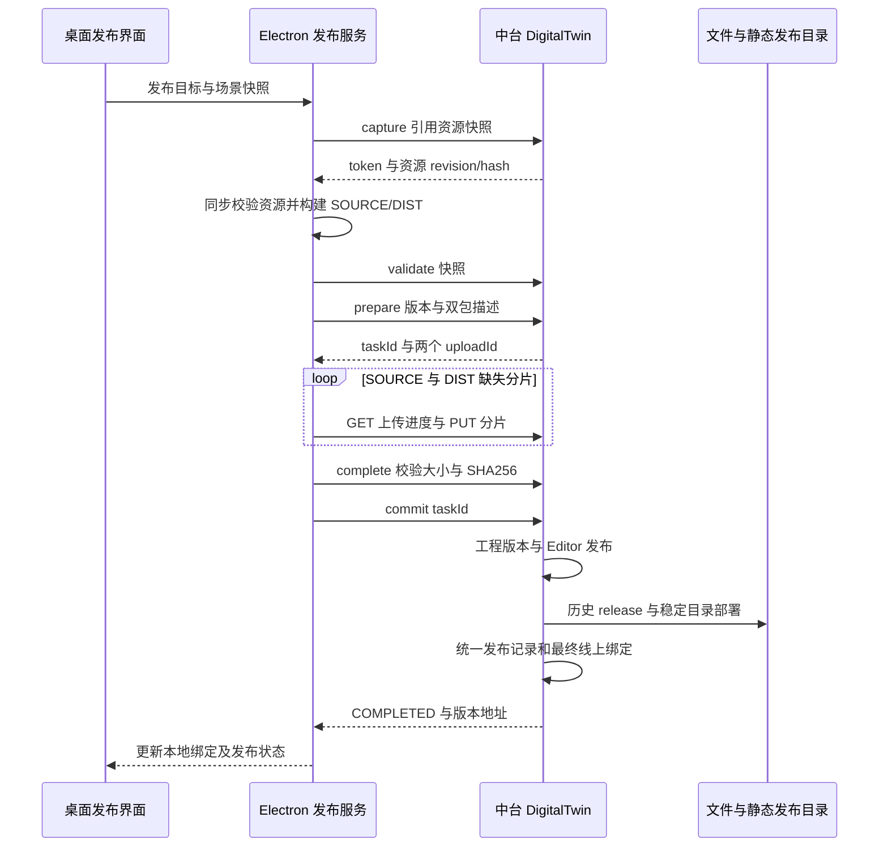
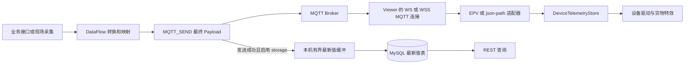

# 跨项目关联与接口契约

[返回总览](README.md) · [三维项目](01-babylon-3d-plus.md) · [中台架构](02-central-data-platform.md) · [运行与维护](04-operations-and-risks.md)

本文为两侧源码交叉核对后的主集成契约，不是全量 OpenAPI，也不表示已完成真实网络联调。阅读基线为 2026-10-27 至 2026-10-28 当前工作树。所有 ID 示例只表达类型，不使用真实业务数据和凭据。

## 集成边界与身份模型

| 链路 | 发起方与接收方 | 用途 |
| --- | --- | --- |
| 深链接 | 中台管理页 → Electron | 打开指定平台的业务项目 |
| REST 资源 | Electron 主进程 → 中台 | 项目、模型、环境、组合、天空、大屏、图标同步 |
| SOURCE 下载 | Electron → 中台 Editor 版本接口 | 恢复可编辑工程 |
| 双包发布 | Electron → 中台 DigitalTwin 接口 | 上传 SOURCE/DIST、创建版本、部署和记录 |
| 运行配置 | 浏览器 Viewer → 中台 | 读取项目启用状态、API/Broker 与父 Origin 配置 |
| MQTT | DataFlow/现场系统 → Broker → Viewer | 设备实时数据；中台不是该浏览器 WS 服务 |
| 数据 HTTP | Viewer/编辑器 → 中台或业务接口 | 库存、特效数据源与设备最新值 |
| 页面桥 | 大屏父页 ↔ Viewer iframe | 握手、设备聚焦、巡检、漫游、点击事件 |

`projectId` 是业务项目身份，`editorProjectId` 是工程中心身份，`versionId` 是工程版本，`publishTaskId` 是数字孪生发布任务，`projectPublishId` 是统一发布记录，不能互换。资源 ID、场景实体 ID 和设备 `assetCode` 也不是同一个命名空间。中台 Long/long 全局输出字符串，前端应持续保留字符串，禁止先转 JavaScript number 再还原。

依据：[Long 序列化](../../../central-data-platform/backend/twin-common-web/src/main/java/com/centraldataplatform/twin/common/web/JacksonLongToStringConfig.java#L16)、[前端 LongId](../../../central-data-platform/frontend/src/services/longId.ts#L1)、[大屏运行绑定](../../../central-data-platform/frontend/src/pages/BigscreenDesigner/utils/digitalTwinRuntimeBinding.ts#L98)。

## HTTP 公共约定与鉴权实况

一般 JSON 响应为 `{success,code,message,data}`；分页 data 为 `{records,total,pageNum,pageSize}`，其中 Long 类型计数也通常字符串化。业务异常多数经全局处理返回 HTTP 400，即使 code 含 NOT_FOUND 或 CONFLICT，也不能自行推断 HTTP 404/409。流式文件、视频 Range、代理请求等不遵循这一统一 JSON 外壳。流程运行外层 success 为 true 时，内部 status 仍可能 FAILED/SKIPPED。

Electron 普通平台传输和数字孪生客户端限制 HTTP(S)、同源下载，拒绝自动重定向；数字孪生 JSON 请求还校验 success、响应大小和超时。当前所查桌面发布客户端不显式注入登录 Bearer。中台登录服务返回匿名用户及 null token，DataFlow 对外 API 的可选 X-API-Key 是独立保护，不能代替后台访问控制。

依据：[ApiResult](../../../central-data-platform/backend/twin-common-web/src/main/java/com/centraldataplatform/twin/common/web/ApiResult.java#L6)、[异常处理](../../../central-data-platform/backend/twin-common-web/src/main/java/com/centraldataplatform/twin/common/web/GlobalExceptionHandler.java#L32)、[平台传输](../../electron/ipc/dataPlatformTransfer.ts#L91)、[发布 HTTP](../../electron/ipc/digitalTwinUploadClient.ts#L256)、[认证实现](../../../central-data-platform/backend/twin-module-system/src/main/java/com/centraldataplatform/twin/system/auth/AuthService.java#L13)。

## 项目打开与资源同步

中台使用 `zending3d://open-project?baseUrl=…&projectId=…` 唤起桌面，桌面另支持可选 `webBaseUrl`。管理页生成 baseUrl 时使用当前页面 origin，不使用开发环境 API_TARGET；因此页面 origin 对应的 `/api` 必须能从桌面访问。工程本地路径按平台来源和项目 ID 隔离，打开已发布项目时下载 latest SOURCE。旧 `/editor/projects/babylon/import/*` 解析 `project.bjseditor`，不是本项目主发布协议的替代入口。

依据：[深链接生成](../../../central-data-platform/frontend/src/services/digitalTwin.ts#L85)、[项目抽屉](../../../central-data-platform/frontend/src/pages/Project/DigitalTwinProjectDrawer.tsx#L108)、[工程恢复](../../electron/ipc/dataPlatformProjectService.ts#L982)、[SOURCE URL](../../electron/ipc/dataPlatformIpc.ts#L782)、[旧导入服务](../../../central-data-platform/backend/twin-module-editor/src/main/java/com/centraldataplatform/twin/editor/app/service/BabylonEditorImportAppService.java#L173)。

| 方法与路径 | 参数/返回要点 | 三维调用入口 |
| --- | --- | --- |
| POST `/api/v1/projects/query`、`/detail` | 列表分页；详情 `{id}` | `dataPlatformIpc.ts` |
| GET `/api/v1/editor/projects/{editorProjectId}/versions/{versionId}/package/export` | SOURCE 文件流，不是 ApiResult | `dataPlatformIpc.ts` |
| POST `/api/v1/models/query`、`/detail` | 普通模型 metadata、主文件、脚本等 | `dataPlatformModelIncrementalSync.ts` |
| POST `/api/v1/combo-models/query`、`/detail` | 简单组合模型，区别于环境 COMPOSITION | `dataPlatformModelIncrementalSync.ts` |
| POST `/api/v1/env-models/sync-manifest/query` | `cursorId/pageSize/manifestRevision`，返回权威修订与文件摘要 | `dataPlatformEnvironmentSync.ts` |
| GET/HEAD `/api/v1/env-models/{id}/file?fileRevision=…` | 固定文件修订、ETag、Range；错误需按具体文件协议处理 | manifest 返回的下载地址 |
| POST `/api/v1/skyboxes/query` | HDR/EXR 资源摘要、大小和修订 | `dataPlatformSkyboxSync.ts` |
| POST `/api/v1/bigscreen-icons/query` | 图标/图片库 | `dataPlatformImageSync.ts` |
| POST `/api/v1/projects/{id}/config/screens/query` | 项目绑定大屏，screenId/name/code/URL/thumbnail | `dataPlatformChartSync.ts` |
| POST `/api/v1/env-models/compositions/query`、`/resolve` | 组合当前修订列表、按 revision/hash 解析 | composition 相关 IPC |
| POST `/api/v1/env-models/compositions/save` | multipart：targetId/baseRevision/operationId/name/compositionFile | `compositionRemote.ts` |
| GET `/api/v1/env-models/compositions/{id}/versions/{revision}` 及 `/definition`、`/package`、`/preview.glb` | 固定组合版本、定义字符串、包或可选预览 | `compositionSceneRecovery.ts` |

客户端证据：[资源同步](../../electron/ipc/dataPlatformModelIncrementalSync.ts#L42)、[环境](../../electron/ipc/dataPlatformEnvironmentSync.ts#L35)、[大屏](../../electron/ipc/dataPlatformChartSync.ts#L236)、[组合保存](../../electron/ipc/compositionRemote.ts#L83)。服务端对应：[项目控制器](../../../central-data-platform/backend/twin-module-project/src/main/java/com/centraldataplatform/twin/project/controller/ProjectController.java#L82)、[环境控制器](../../../central-data-platform/backend/twin-module-env-model/src/main/java/com/centraldataplatform/twin/envmodel/controller/EnvModelController.java#L111)、[组合控制器](../../../central-data-platform/backend/twin-module-env-model/src/main/java/com/centraldataplatform/twin/envmodel/controller/EnvCompositionController.java#L18)、[版本包导出](../../../central-data-platform/backend/twin-module-editor/src/main/java/com/centraldataplatform/twin/editor/controller/EditorProjectVersionController.java#L77)。

普通模型库同步与项目场景固定资源版本不同；大屏列表则明确受项目绑定约束。环境 manifest 的请求 revision 不是服务端完整跨页冻结令牌，客户端需要处理分页间 revision 变化。`integration/projects/detail` 是中台另一个实时聚合接口，不是当前桌面主资源同步入口，也不是历史发布快照。

依据：[manifest 服务](../../../central-data-platform/backend/twin-module-env-model/src/main/java/com/centraldataplatform/twin/envmodel/app/service/EnvModelSyncManifestService.java#L35)、[实时聚合](../../../central-data-platform/backend/twin-module-integration/src/main/java/com/centraldataplatform/twin/integration/app/service/TwinIntegrationAppService.java#L122)。

## SOURCE/DIST 发布时序

图按主业务顺序表达；具体快照验证和资源准备可能多次发生。SOURCE 是多场景可回编辑工程，DIST 是入口场景的自包含 Viewer 资源。数字孪生 DIST 清理公开场景的 Fetch API Key，SOURCE 按设计保留编辑配置，不能因 DIST 已清理就公开 SOURCE。

所有下列后缀均相对 `/api/v1/digital-twin`。

| 方法与后缀 | 核心输入 | 返回/语义 |
| --- | --- | --- |
| POST `/resource-snapshots/capture` | projectId、modelIds/envModelIds/comboModelIds、compositionVersions | token、resourceRevision、引用资源文件 hash/size |
| POST `/resource-snapshots/validate` | projectId、resourceSnapshotToken | 重新核对引用内容；失效或变更报错 |
| POST `/publish-tasks/prepare` | requestId、projectId、baseVersionId、覆盖标志、名称、入口、manifestJson、resourceRevision、可选 token、资源 IDs、双包描述 | 发布任务与 SOURCE/DIST 上传会话 |
| GET `/uploads/{id}` | uploadId | chunkSize、uploadedChunks、receivedBytes、状态等 |
| PUT `/uploads/{id}/chunks/{index}` | 原始二进制 body | 分片进度；不是 multipart 或 JSON |
| POST `/uploads/{id}/complete` | 路径 uploadId；客户端发送空对象 | 检查分片、总大小与 SHA256，持久文件 |
| POST `/publish-tasks/commit` | `{taskId}` | 继续可恢复发布步骤；客户端要求 COMPLETED |
| POST `/publish-tasks/cancel` | `{id: taskId}` | 非 PROCESSING/COMPLETED 状态按规则取消 |
| POST `/publish-tasks/query`、`/detail` | 分页条件；详情 `{id}` | 任务状态及关联版本 |
| POST `/projects/status` | `{projectId}` | UNBOUND/ACTIVE/OFFLINE、latest/online 及地址 |
| POST `/runtime-config/detail`、`/save` | projectId；保存运行连接字段 | 项目级动态配置 |
| POST `/publishes/rollback` | projectPublishId、publishName | 新回滚记录，同步 SOURCE 与 DIST 版本 |
| POST `/projects/offline` | projectId | 下线稳定目录；历史目录保留 |

包描述为 `{fileName,fileSize,sha256}`，大小等 Long 按字符串传输。prepare 的 `requestId` 必须绑定一次不变的尝试，不可换包后复用。commit 使用 taskId，cancel 使用 id，这是容易写错的字段差异。

依据：[客户端方法与 DTO](../../electron/ipc/digitalTwinUploadClient.ts#L79)、[后端控制器](../../../central-data-platform/backend/twin-module-editor/src/main/java/com/centraldataplatform/twin/editor/controller/DigitalTwinController.java#L60)、[prepare DTO](../../../central-data-platform/backend/twin-module-editor/src/main/java/com/centraldataplatform/twin/editor/app/dto/DigitalTwinPublishPrepareDTO.java#L13)。

后端默认分片 16 MiB、会话 24 小时，均可配置；complete 才验证整体哈希。客户端先获取进度，只补缺片，分片瞬态错误最多额外重试 3 次；这不等于 prepare/complete/commit 全部自动无限重试。服务端 commit 是可恢复分步编排，部署先于统一发布记录和最终线上绑定，且存在部署前 latestVersionId 更新；不可描述为数据库与文件系统原子提交。

依据：[分片服务](../../../central-data-platform/backend/twin-module-editor/src/main/java/com/centraldataplatform/twin/editor/app/service/DigitalTwinUploadAppService.java#L142)、[分片重试](../../electron/ipc/digitalTwinUploadClient.ts#L153)、[commit 顺序](../../../central-data-platform/backend/twin-module-editor/src/main/java/com/centraldataplatform/twin/editor/app/service/DigitalTwinPublishAppService.java#L203)。

### 版本与快照不变量

旧客户端无快照 token 时按全局资源 revision 校验；新模式按本次引用集合及固定组合修订检查，允许未引用资源变化。但是桌面 `assertPreparedPublishTask` 在未确认补绑时仍要求响应全局 revision 等于请求 revision，存在服务端接受而客户端拒绝的条件性兼容风险。该差异已经独立静态复核，尚未动态复现。

forceOverwrite 只处理 prepare 时已有版本；commit 仍校验记录的 baseVersionId，不能用它绕过后续并发发布。资源快照票据保证引用一致性，不是身份访问令牌。rollback 会同步 latest 编辑版本和 online 版本，但不冻结/恢复全部运行配置、实时数据或大屏发布。

依据：[资源快照验证](../../../central-data-platform/backend/twin-module-editor/src/main/java/com/centraldataplatform/twin/editor/app/service/DigitalTwinResourceSnapshotService.java#L52)、[客户端 revision 断言](../../electron/ipc/digitalTwinUploadClient.ts#L392)、[版本校验器](../../../central-data-platform/backend/twin-module-editor/src/main/java/com/centraldataplatform/twin/editor/app/service/DigitalTwinPublishValidator.java#L25)、[回滚与下线](../../../central-data-platform/backend/twin-module-editor/src/main/java/com/centraldataplatform/twin/editor/app/service/DigitalTwinPublishAppService.java#L365)。

## Viewer 运行配置与部署地址

数字孪生包内 `runtime-config.json` 为 v2，含 projectId 和根相对 `/api/v1/digital-twin/runtime-config/detail`。Viewer 启动时 POST `{projectId}` 获取 `mqttBrokerUrl/apiBaseUrl/runtimeEnabled/configJson/updatedAt`，核对项目身份。`runtimeEnabled:false` 阻断启动，不代表对已打开 Viewer 实时踢下线。中台拒绝运行配置中的密码、token、API Key 等敏感键，公开配置不是密钥保管点。

稳定地址为有效 publicBaseUrl 下的 `/projects/{projectId}/`，历史地址为 `/releases/{projectId}/{publishNumber}/`；通常 publicBaseUrl 自带 `/digital-twin` 前缀。大屏 projectStable 绑定会优先固定本次查到的 releaseUrl，projectRelease 使用 publishTaskId 查询已完成任务。offline 清稳定入口，但不自动删除所有历史 release；如需彻底停止访问，另设计历史文件访问和运行配置策略。

依据：[DIST 配置写入](../../electron/ipc/digitalTwinDistPackage.ts#L220)、[Viewer 获取配置](../../src/player/PlayerApp.tsx#L150)、[运行配置校验](../../../central-data-platform/backend/twin-module-editor/src/main/java/com/centraldataplatform/twin/editor/app/service/DigitalTwinProjectAppService.java#L107)、[地址构造](../../../central-data-platform/backend/twin-module-editor/src/main/java/com/centraldataplatform/twin/editor/app/service/DigitalTwinDeploymentPaths.java#L16)。

## MQTT 消息与设备驱动

默认 EPV topic 为 `dt/factory/logistics/{deviceType}/{assetCode}/twindatadriven/joint`。消息 `data` 是 `{e,p,v,s?}` 项数组，`p` 为点位字段、`v` 为值，`e` 缺省或与 topic 资产编号一致时接受；可带 `ts/seq/sequence`。json-path adapter 可以从其他正文结构映射设备类型、资产编号、时间、序号及业务 fields。必须由业务方约定具体设备的点位含义和单位，中台不会自动将任意数据转换为正确运动。

订阅配置为 `subscriptions:[{topic,qos,adapter}]`，通配符遵循 MQTT `+/#`。同一消息按第一个匹配订阅选择 adapter，不是向全部匹配配置重复分发。底层部分类型可表示 QoS 2，但发布 Viewer 严格解析仅允许 QoS 0/1、最多 32 个订阅，不能从底层类型推断发布态可用范围。

依据：[协议和 EPV 解析](../../src/runtime/mqtt/deviceTelemetry.ts#L70)、[匹配订阅](../../src/runtime/mqtt/MqttTelemetryClient.ts#L248)、[发布配置限制](../../src/player/runtimeConfig.ts#L168)。

Electron 有主进程 MQTT IPC 路径，Viewer 使用浏览器 MQTT.js，两者当前正式连接都要求 ws/wss。浏览器连接 clean=true、随机 clientId、8 秒连接超时、3 秒重连，每次 connect 后重新订阅。乱序/重复数据不会推进历史快照，但仍可能保留心跳通知语义。该实现不承诺断网期间自动恢复全部消息，需结合 Broker retained、QoS 和上游重发策略。

中台 MQTT_SUBSCRIBE 得到的是 `{topic,payload,payloadText,payloadFormat,qos,retained,payloadBytes,receivedAt}` 事件行，不是 Viewer EPV 消息自动适配结果。设备最新值只有 MQTT_SEND 真正成功且启用 storage 后才进入异步缓冲；幂等跳过不提交最新值，查询只读已持久化数据。namespace/deviceType/deviceNo 是最新值查询键，没有自动 projectId 隔离。

依据：[浏览器连接](../../src/runtime/mqtt/MqttTelemetryClient.ts#L89)、[Electron MQTT](../../electron/ipc/mqttIpc.ts#L491)、[中台订阅](../../../central-data-platform/backend/twin-module-dataflow/src/main/java/com/centraldataplatform/twin/dataflow/run/app/service/DataFlowMqttSubscribeService.java#L240)、[成功发送后提交](../../../central-data-platform/backend/twin-module-dataflow/src/main/java/com/centraldataplatform/twin/dataflow/run/app/service/DataFlowSendService.java#L274)。

## 两种 HTTP 数据契约

| 链路 | 请求 | 响应与注意点 |
| --- | --- | --- |
| 库存/库位 Fetch | 场景 `fetchConfig.url`，POST `{rows}`；编辑配置可带 X-API-Key | 读取 `data.records[].result[]`，需要容器及库位字段；不是固定中台 URL |
| 特效数据源 | POST `/api/v1/data-sources/fetch`，`{id,runParams:{assetCode}}` | data 包含 statusCode/durationMs/responseBody/message，responseBody 为字符串 |
| 特效最新值 | POST `/api/v1/dataflow/mqtt-storage/detail`，`{namespace,deviceType,deviceNo:assetCode}` | `{device,payloadJson}`，payloadJson 为字符串；不是 records 数组 |
| 流程对外 API | POST `/api/v1/dataflow/open/apis/{apiCode}/invoke`，业务参数，按配置带 X-API-Key | 当前 PUBLISHED 的本次运行 records；需检查内部 status |

库存记录字段包括 `containerCode/containerType/isEmpty/locType/row/column/layer/tier/stackingRow/stackingColumn/stackingLayer`。默认间隔 60 秒，0 表示进入预览时只同步一次。若使用 DataFlow 外部 API 供库存，DAG 必须输出符合 `records[].result[]` 的行结构；普通“成功返回 records”不能保证三维能解析。数字孪生 DIST 清空 Key 后，要求 Key 的库存接口也不会自动获得授权，需要单独设计安全的运行态接入方式，而不是把密钥重新放进公开包。

依据：[库存请求与解析](../../src/runtime/babylon/scene-runtime/SceneLocatorFetchController.ts#L350)、[特效契约](../../electron/shared/effectDataContract.ts#L40)、[数据源返回结构](../../../central-data-platform/backend/twin-module-dataflow/src/main/java/com/centraldataplatform/twin/dataflow/datasource/app/vo/DataSourceTestResultVO.java#L3)、[最新值查询](../../../central-data-platform/backend/twin-module-dataflow/src/main/java/com/centraldataplatform/twin/dataflow/mqttlatest/MqttLatestQueryService.java#L28)、[外部 API 返回](../../../central-data-platform/backend/twin-module-dataflow/src/main/java/com/centraldataplatform/twin/dataflow/flowapi/app/vo/FlowApiInvokeResultVO.java#L11)。

## 大屏与 Viewer 页面桥

主协议 channel 为 `zending.digital-twin.bridge`、version 为 1。宿主发送 `host.hello`，Viewer 应答 `bridge.ready`，场景可交互后发送 `viewer.ready`。sessionId 隔离当前页面会话，requestId 关联命令结果。宿主校验 iframe contentWindow、source、origin、sessionId 和可用的 projectId；Viewer 校验父窗口及允许的 Origin。跨源父页面通过 `configJson.integration.allowedParentOrigins` 配置；`*` 会放开来源，不宜作为默认解决方案。

| 消息/能力 | 用途 |
| --- | --- |
| host.hello / bridge.ready / viewer.ready | 能力和就绪握手 |
| viewer.initialLoadState | 初始加载进度与状态 |
| focusAsset / cancelFocusAsset / clearSelection | 聚焦设备、取消与清选 |
| globalOverview / startAutoPatrol / startManualRoam | 总览、巡检和漫游 |
| command.result | 按 requestId 返回命令结果 |
| event.assetClicked | 设备/库位点击，可含 assetCode/slot/chartId |
| viewer.showScreen | 请求展示关联大屏 |

依据：[Viewer 协议](../../src/player/digitalTwinInteractionProtocol.ts#L1)、[中台同协议](../../../central-data-platform/frontend/src/pages/BigscreenDesigner/utils/digitalTwinInteractionProtocol.ts#L1)、[Viewer Origin 校验](../../src/player/DigitalTwinInteractionController.ts#L247)、[宿主桥实现](../../../central-data-platform/frontend/src/pages/BigscreenDesigner/utils/digitalTwinRuntimeHostBridge.ts#L378)。

反向“Viewer 内嵌大屏”还涉及 embed-ready、纹理截图和独立选择桥，不能把主桥的双端实现套用于所有扩展。截图存在更严格的同源边界；`zending.data-platform-screen.bridge` 的 selection/focus 完整中台内置对端在本次搜索中未确认。自定义脚本或部署侧扩展是否补齐，需实际项目确认。

## 联调排障顺序

页面能打开但设备不动时，先分别验证静态模型、runtime-config、Broker WS/WSS 连接、SUBACK、topic/adapter、资产编号和点位单位，不要只检查中台 REST。iframe 能加载但按钮无效时，应单独检查主桥版本、Origin、session 和 ready 状态。发布失败则区分资源快照、prepare 版本校验、分片/complete、commit 部署和最终记录；不能只凭任务 FAILED 认定线上目录完全没变。

主契约变更应同时检查 Electron 客户端、Java Controller/DTO/Service、Player 严格解析器和中台大屏宿主；其中任何一端只改类型而不改运行校验，都可能出现构建通过但联调失败。所列场景为后续验收建议，本次未运行上述流程。
