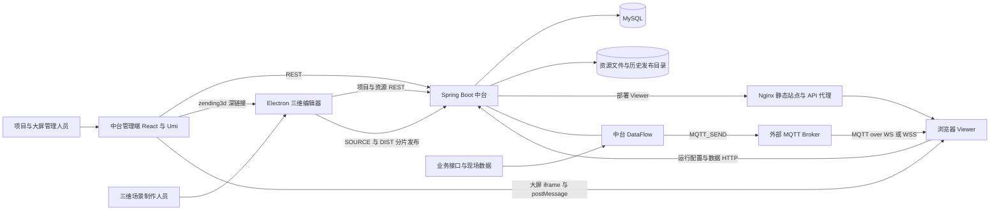

# 数字孪生双项目技术交接

本文档组面向接手开发、联调与运维的工程师，梳理 `babylon-3d-plus` 与 `central-data-platform` 的职责、源码结构、跨项目契约及维护边界。阅读时间为 2026-10-27 至 2026-10-28，结论来自当前工作树的源码、配置、迁移与测试源码，不以需求规划代替实现。

## 阅读导航

| 文档 | 回答的问题 |
| --- | --- |
| [三维编辑器与 Viewer](01-babylon-3d-plus.md) | 场景如何编辑、加载、驱动、保存和打包？桌面与浏览器有何差异？ |
| [数据中台技术架构](02-central-data-platform.md) | 管理端、19 个 Maven 模块、数据模型、数据流、资源和存储如何协作？ |
| [跨项目关联与接口契约](03-integration-contracts.md) | 项目、资源、SOURCE/DIST、MQTT、HTTP 与 iframe 协议如何对应？ |
| [启动部署、维护风险与验收](04-operations-and-risks.md) | 如何安全准备运行环境？哪些风险已在源码确认，哪些还需实测？ |
| [文档复核记录](05-verification.md) | 阅读和验证覆盖到哪里？哪些事情没有执行？ |

初次接手宜先读本页，再读跨项目契约；负责三维、后端或运维时按职责进入专项文档。文档的源码链接以本组位于 `babylon-3d-plus/docs/technical-handover/`、两仓库为同级目录为前提。代码链接附 `#L行号` 供支持该语法的平台定位；本地 Markdown 阅读器可能只打开文件，不跳转行号。

## 核心关系

`babylon-3d-plus` 不是中台的一个页面，也不是仅展示模型的前端。它产出 Electron 桌面编辑器和可独立部署的浏览器 Viewer，承担场景创作、模型参数化、设备运动、货物和光照等三维能力。`central-data-platform` 是 React 管理端加 Spring Boot 模块化单体，承担共享资源、项目关联、数据编排、大屏、工程版本、发布部署和运维能力。两个仓库独立构建，经 HTTP、部署文件、深链接、MQTT 和页面消息协议协作，没有证据表明它们共享同一个前端运行时或统一发布事务。

图中 MQTT Broker 是外部基础设施，不是中台实现的 WebSocket 服务；Viewer 与大屏之间的 `postMessage` 也不经过 Broker。中台另有原始 TCP/UDP 接收与发送能力，不能与浏览器 WebSocket 混为一谈。

依据：[桌面入口](../../electron/main.ts#L176)、[中台聚合 POM](../../../central-data-platform/backend/pom.xml#L14)、[数字孪生控制器](../../../central-data-platform/backend/twin-module-editor/src/main/java/com/centraldataplatform/twin/editor/controller/DigitalTwinController.java#L39)、[Viewer MQTT 客户端](../../src/runtime/mqtt/MqttTelemetryClient.ts#L89)、[宿主桥接](../../../central-data-platform/frontend/src/pages/BigscreenDesigner/utils/digitalTwinRuntimeHostBridge.ts#L144)。

## 一条完整业务链

业务人员在中台维护项目、模型、环境、大屏与数据源，三维人员从中台项目深链接或桌面首页打开工程。桌面取得本地 SOURCE 工程及共享资源，在场景内配置模型参数、设备资产编号、库位、特效、巡检、漫游和 MQTT/HTTP 数据绑定。运行预览驱动设备状态，但停止后恢复设计基线，不应把实时姿态等同场景编辑内容。

数字孪生发布先锁定本次引用资源，再构建可继续编辑的 SOURCE 和可在浏览器运行的 DIST。中台完成分片校验、工程版本创建及静态部署，并记录稳定地址和历史地址。大屏可以 iframe 嵌入 Viewer，通过设备聚焦和点击消息联动。Viewer 启动时重新读取项目运行配置；三维版本、项目运行配置、大屏发布和实时数据并非一个共同冻结的版本。

依据：[发布编排](../../electron/ipc/digitalTwinPublishService.ts#L480)、[后端发布步骤](../../../central-data-platform/backend/twin-module-editor/src/main/java/com/centraldataplatform/twin/editor/app/service/DigitalTwinPublishAppService.java#L203)、[Viewer 启动读取配置](../../src/player/PlayerApp.tsx#L150)。

## 责任与资产边界

| 对象 | 主要权威来源 | 交接时必须区分 |
| --- | --- | --- |
| 三维设计场景 | 桌面版本化场景 JSON、已发布 SOURCE | 不是中台 `dt_scene` 的 GLB 文件，也不是旧 `project.bjseditor` |
| 共享模型与环境 | 中台资源记录及磁盘文件 | 资源库最新版本不等于场景固定使用版本 |
| 三维运行包 | 数字孪生 DIST、历史 release | 不能用它替代可编辑 SOURCE 备份 |
| 大屏 | `dt_screen` 草稿与 `dt_screen_publish` 快照 | 大屏发布不等于三维发布 |
| 数据流 | `df_flow` 草稿与 `df_flow_publish` 快照 | 流程发布不冻结其引用数据源的全部外部配置 |
| 设备最新值 | MQTT_SEND 后的异步 MySQL 最新值存储 | 不是 MQTT 订阅历史，也不是每条消息立即落库 |
| 运行连接配置 | 项目级 runtime-config | 回滚三维包不自动回滚该配置 |
| 文件与归档 | MySQL 元数据加本地磁盘 | 仅备份数据库不足以恢复模型、脚本、视频和发布产物 |

上述资产边界分别见 [场景序列化](../../src/editor/project/SceneSerializer.ts#L111)、[中台场景控制器](../../../central-data-platform/backend/twin-module-scene/src/main/java/com/centraldataplatform/twin/scene/controller/SceneController.java#L89)、[大屏发布](../../../central-data-platform/backend/twin-module-screen/src/main/java/com/centraldataplatform/twin/screen/app/service/ScreenPublishService.java#L64)、[流程发布](../../../central-data-platform/backend/twin-module-dataflow/src/main/java/com/centraldataplatform/twin/dataflow/flow/app/service/DataFlowPublishService.java#L89)、[MQTT 发送](../../../central-data-platform/backend/twin-module-dataflow/src/main/java/com/centraldataplatform/twin/dataflow/run/app/service/DataFlowSendService.java#L274)。

## 当前交接判断

架构与主集成链已经有大量实际实现，不能将项目概括为只有工程骨架；但也不能因此宣称生产部署、完整安全边界、全量测试和端到端联调已经完成。当前中台认证服务返回匿名身份；模型 TS 脚本在三维运行时执行，属于可信代码扩展；发布涉及数据库与文件系统，并非全局原子事务。这些是上线与接手前需要明确的工程约束，而不是本次已完成的整改。

静态复核还确认：普通 Web 导出与数字孪生 DIST 的 Fetch API Key 清理不同；引用资源快照与客户端全局 revision 断言存在条件性兼容风险；大屏更新时间并发检查被注释。具体证据、影响条件与待验证项统一放在[运行与维护文档](04-operations-and-risks.md)，避免把风险推断写成已发生事故。

## 证据与维护口径

“源码事实”指当前实现直接支持的结论；“风险推断”指可由调用链解释、但尚未经动态复现的影响；“待验证”指真实环境、依赖、网络、数据库、GPU 或测试结果仍需确认。本次没有安装依赖、启动服务、运行项目构建测试、连接数据库/Broker，也未读取模型等大型二进制内容。阅读按模块、入口和关键调用链开展，不是对全部文件逐行审计。

记录时 Git HEAD 为三维仓库 `5d7a684`、中台仓库 `c9c70fe`，两仓库均显示大量工作树差异。HEAD 仅作定位参考，不能代表被阅读内容已经冻结在这些提交中；后续代码变动应重新核实相关结论和行号。本文档组只新增文档，不覆盖已有业务代码或已有技术文档。
