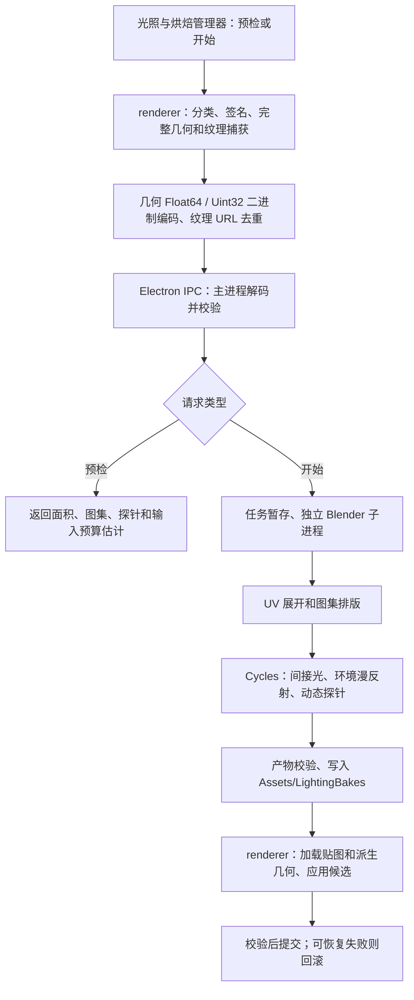

# 数字孪生编辑器烘焙性能与大场景稳定性评估

日期：2026-10-26  
对象：`F:\babylon-3d-plus`，ZENDING 3D EDITOR 0.4.2  
代码基线：本次读取时 Git HEAD `109f827`；`@babylonjs/core` 声明 `^9.12.0`，本地安装版本 `9.12.0`。  
文档性质：第 1–8 节保留整改前的实现审查、历史证据与处理建议；其中“当前”指初次评估基线。用户随后授权按方案整改，实施状态与新验证见第 9 节，不能用旧风险描述代替修改后的实际行为。

## 1. 结论与证据边界

| 用户关心的问题 | 本次结论 | 可信边界 |
| --- | --- | --- |
| 烘焙后是否提高性能 | **不能保证，也没有足够证据认定当前场景已经提高帧率。** 当前实现主要离线生成静态间接光和环境漫反射；直接光、高光、反射及动态阴影继续运行。增加光照贴图、派生几何、有效性检查和探针采样后，帧率可能上升、持平或下降。 | 计算路径已由代码确认；具体收益需要同场景、同设备的独立对照。烘焙计算变快、画面变好，都不等于运行帧率提高。 |
| 大场景为何在烘焙时崩溃 | **当前捕获、编码和 IPC 链路存在明确的大场景内存放大风险。** 用户补充现象为“点击预检或开始后，尚未明显进入计算”，因此优先排查 renderer 捕获和传输，而非先归因于 Cycles 显存不足。 | 这是最高优先级的工作假设，尚无本次事故的进程退出原因、调用栈或内存转储，不能认定唯一根因。 |
| 是否已有对应历史证据 | 有。历史完整环境案例在“显式预检后再次捕获”路径上，renderer 堆观察值达到 `2,285,073,053 B`，超过该检查脚本预先设定的 `2 GiB` 限额后正常取消，尚未进入 Cycles。 | **历史受控取消不是编辑器真实崩溃；2 GiB 是该次检查预算，不是 Electron 通用硬上限，也不是现有产品统一内存保护。** |
| 首要处理方向 | **把预算检查前移到大对象分配之前，将全量捕获和全量 IPC 改成有界传输；保留正确性校验和原有效结果。** | GPU 切 CPU、降低 samples、增加贴图预算，均不能直接解决前端捕获内存峰值。 |

证据分为三类：**当前代码事实**、**已保存的历史观察**、**待实现或待测的建议**。本次只对所列直接相关入口和材料作分析，不以历史测试通过替代当前运行验收，不把用户描述的“崩溃”擅自等同于 OOM。

## 2. 当前烘焙实际做了什么

### 2.1 端到端流程

关键点：**当前预检不是低成本的元数据检查，而是先完整捕获，再估算。** 入口 `preflightLightingBake()` 先调用 `captureBakeInput()`，再编码并通过 IPC 请求预检；正式开始会重新捕获。两次捕获之间没有可证明的 GC 完成屏障，前一次垃圾未回收时可能叠加峰值。[S1–S3]

### 2.2 烘焙与实时渲染的职责

| 项目 | 当前处理方式 | 对性能的含义 |
| --- | --- | --- |
| 静态间接光 | Blender/Cycles 离线求解，保存 RGBM 光照图 | 避免在运行时求解同等复杂的多次反弹，但原场景未必原本就启用了同等实时 GI，因此不能直接计为“节省”。 |
| 环境漫反射 | 烘焙结果在材质插件内替换或补入漫反射项 | 仍有纹理采样、RGBM 解码及材质运算；不是将材质变为无光照材质。 |
| 直接光、高光、环境反射 | 保留原生实时路径 | 其灯光和反射成本不会因 GI 烘焙完成而自动消失。 |
| 静态阴影 | 混合阴影系统支持缓存与失效刷新 | 可能减少静态投影重复绘制，但这是阴影缓存的独立收益，应与 GI 收益拆开统计。 |
| 动态阴影 | 实时处理，受 `dynamicShadows` 等配置控制 | 设备运动、人员漫游、动态遮挡仍有实时成本。 |
| 动态对象间接光 | 根据位置更新探针绑定，并进行遮挡查询 | 不再跑离线求解，但 CPU 更新成本不为零。 |
| 场景几何 | 为接收表面创建派生 Mesh 和独立光照 UV；保留原场景用于编辑和恢复 | 不做通用减面，也不自动合并绘制调用；可能增加几何驻留并影响原实例复用。 |

Cycles 中 `bake_irradiance()` 明确关闭直接光 pass、开启间接光 pass，并在需要时增加环境漫反射求解。`BakedLightingMaterialPlugin` 对 PBR 的 `finalIrradiance` 进行处理，保留原材质高光等项。[S4–S5]

Babylon.js 的原生 lightmap 与 `Light.lightmapMode` 提供不同的直接光/高光组合机制，但本项目使用自定义材质插件，不能直接套用“全部灯光烘进贴图后删除灯光”的性能结论。[Babylon.js 灯光文档](https://github.com/BabylonJS/Documentation/blob/master/content/features/featuresDeepDive/lights/lights_introduction.md)

## 3. 烘焙后的性能收益如何判断

### 3.1 收益的成立条件

实际净收益应按下式理解，不能提前给出百分比：

`净节省 = 被真正移除的实时成本 − 新增贴图/几何/材质/探针/有效性维护成本`

其中 CPU 与 GPU 可能并行工作，端到端帧耗时通常受较慢的一侧、同步等待和长任务限制，不能把所有计时简单相加。

| 场景瓶颈 | 当前 GI 烘焙的预期影响 | 应对方向 |
| --- | --- | --- |
| CPU：大量 Mesh、分类、业务脚本、矩阵更新 | 通常不能直接解决；GI 生效后还要维护源对象状态 | 优先按实际采样确定热点，再处理分类失效、派生对象规模和探针更新。 |
| GPU：频繁绘制静态阴影 | 静态阴影缓存可能有效 | 固定 GI 开关，单独比较缓存的命中、重绘和渲染目标耗时。 |
| GPU：复杂实时光照 | 只有确实减少对应运行时计算才可能改善 | 当前混合路径保留直接光，不承诺通用提速。 |
| 显存或系统内存紧张 | 新增图集和派生几何可能恶化 | 先建立总驻留预算、限制同时加载量，再考虑更多光照资产。 |
| 原本只有简单环境光、没有实时 GI | 主要是增加画面表现，可能付出额外成本 | 将其作为画质选项评估，明确目标机器可承受的成本。 |

Babylon.js 官方明确说明，静态世界可让阴影贴图只刷新一次；点光源阴影涉及 cubemap，成本需单独评估。本项目已有混合阴影缓存，因此正确做法是检查缓存是否有效，不能把相同能力重复列为新方案。[Babylon.js 阴影文档](https://doc.babylonjs.com/features/featuresDeepDive/lights/shadows/)

### 3.2 当前可确认的额外开销

1. **派生几何和绘制组织。** `prepareState()` 对结果中的每个接收表面创建 `__LightingDerived_*` Mesh 并上传顶点属性。原始几何仍供编辑、签名和回滚使用。原有共享几何或 thin instance 的低成本结构不一定能直接沿用到每个独立烘焙结果。[S6]
2. **运行时维护。** `tick()` 在有效 GI 状态下遍历静态监视对象，核对姿态、显隐、材质和灯光等；动态对象移动后更新探针。已有缓存和跳过条件，但不是“烘焙后不再计算光照相关逻辑”。[S6]
3. **资源驻留。** PNG 的磁盘压缩大小不等于 GPU 纹理大小；纹理解码、恢复所需的 `ImageBitmap`、几何数组及 GPU 缓冲还会占用 CPU/GPU 内存。[S7]
4. **结果切换峰值。** 新资源加载完成并通过候选验证之后才释放上一套有效结果。该事务保证可恢复性，但重烘焙应用时存在新旧资源重叠的窗口。[S6–S7]

当前派生几何已经实现完整属性逐字节一致时的顶点复用，并支持二进制输出；不能描述为“所有输出始终完全去索引”或“尚未做任何几何压缩”。光照 UV 接缝、硬法线和不同光照结果仍会限制复用。[S4、S11]

### 3.3 必须区分的三种“变快”

- **生成变快：** 从点击开始到离线资产生成完成。
- **加载变快：** 从打开场景/应用结果到画面可交互。
- **运行变快：** 稳态帧时间、卡顿分位数、CPU/GPU 耗时改善。

现有 Q0 文档记录的探针批次优化是局部离线生成耗时观察，不是烘焙前后 FPS 对照；其他编辑器或 Viewer 的优化记录也不能归因于 GI。本次没有找到能直接回答当前用户场景“烘焙前后净帧率收益”的完整配对证据。[H4]

另一个容易误判的入口是“查看烘焙前”：当前 `setPreview()` 主要切换 `binding.enabled` 并更新光照策略，**不会卸载已驻留的派生几何和贴图**。它适合比较效果，不适合单独证明完整内存或加载性能收益。[S6]

## 4. 大场景崩溃：证据、优先级及不能下的结论

### 4.1 已保存的相关历史案例

来源：[完整环境失败报告](../output/phase2-completion-20261025/gi-environment-cpu-v2-1/report.json)、[对应内存调查](../output/phase2-completion-20261025/gi-memory-assessment.json)。以下为历史观察，本次没有重跑。

| 指标 | 历史值 | 说明 |
| --- | ---: | --- |
| 捕获网格 / 三角面 | 798 / 866,611 | 不能据此推导所有 86 万面场景均会失败；材质分组、属性和纹理不同，内存差异很大。 |
| 输入数值估算 | 269,747,432 B，约 257.25 MiB | 不是总堆内存，也不含所有中间对象。 |
| 二进制几何 | 259,252,608 B，约 247.24 MiB | 几何已经是二进制，不能再归因为“几何全量 Base64”。 |
| 唯一捕获纹理 | 151 个 PNG URL；PNG 合计 139,648,760 B | Base64 主要存在于材质 PNG URL，字符串占用及传输副本不能直接按字符数等同堆字节。 |
| 首次捕获堆观察值 | 1,172,573,655 B，约 1.09 GiB | `performance.memory.usedJSHeapSize` 采样值。 |
| 预检 IPC 后堆观察值 | 1,553,108,266 B，约 1.45 GiB | 不是 renderer 的全部 OS 工作集。 |
| 失败运行堆最大观察值 | 2,285,073,053 B，约 2.13 GiB | 超过该检查脚本的 2 GiB 限额，触发正常取消；不是捕获到进程 OOM 退出。 |
| 实际设置 | CPU / preview / 1024 图集 / 4 px/m / 16 m 探针间距 / 256 MiB 纹理预算 | 已采用较低烘焙参数，仍发生前端堆超限；说明只降 samples 或图集参数不足以消除捕获风险。 |

历史报告只保存首次捕获的完整元数据，没有第二次编码入口标记和 heap-retainer 分析，无法把第二轮峰值精确分摊到捕获、编码、IPC 或尚未回收垃圾，也不能据此证明持续内存泄漏。

另一份[直接开始报告](../output/phase2-completion-20261025/gi-environment-direct-start-v2-1/report.json)省去额外显式预检，renderer 最大观察值约 1.68 GiB，进入了 Blender，但检查脚本在 `600000 ms` 截止时仍未完成 UV 阶段，结果是 `FAIL`。**这只说明那一次避开了相同的前端预算超限，不代表全场景烘焙成功，更不证明重复捕获问题已修复。** 10 分钟是该次检查期限，产品服务默认烘焙超时为 6 小时。[H2、S8]

当前代码已增加 IPC 纹理 URL 字典，历史内存调查里的“建议增加字典”已部分落地；不能把旧峰值当作当前版本必然达到的数值，也不能凭字典小样就认定真实大场景问题已经解决。[S3、H3]

### 4.2 按阶段定位风险

| 阶段 | 当前事实与风险 | 本次优先级 |
| --- | --- | --- |
| renderer 捕获 | `exportLightingMesh()` 每个 primitive 复制完整 `positions/normals/UV/colors/tangents`；索引用 `Array.from(indices).slice(...)`，会先构造全索引临时数组。重复实例与多材质网格可放大数据量。纹理还会经过 GPU 读回、RGBA、PNG 和 Base64 表达。 | **最高。** 与用户发生阶段直接一致；当前代码仍存在。 |
| 预算预检 | 完整捕获和编码发生在预算拒绝之前；几何数值超过 256 MiB 当前只是 warning，缺少 renderer 总内存准入门。 | **最高。** 预检本身可能成为危险操作。 |
| IPC / 主进程 | 编码新增 ArrayBuffer；主进程 `decodeLightingBakeTransport()` 又生成完整 `number[]`。当前有二进制文件复用和 URL 去重，仍不是端到端零复制。 | **高。** renderer 和主进程分别占内存；不能把二者混成同一个 JS heap。 |
| Blender 建场 / UV | 当前先加载全部输入、建立网格、展开并排版，再逐图集计算；逐图集输出不意味着整场景已分块驻留。 | 中。仅当已进入该阶段再作为主因排查。 |
| 图集 / 探针计算 | Float32 图像、第二 pass、数组编码、场景加速结构和源纹理同时占用 RAM/VRAM。探针有自适应缩批，但不覆盖前端捕获和全部场景几何。 | 中。不能以“存在 GPU 回退”推导整个流程不会 OOM。 |
| 结果应用 | 资源默认最多 4 项并发加载，全部验证后返回；原场景、上一套 GI、新候选 GI 可能同时驻留。 | 后续必须覆盖，但与用户当前发生阶段不一致。 |

### 4.3 已有保护及其缺口

| 已有能力 | 保护范围 | 未覆盖的部分 |
| --- | --- | --- |
| 4096 探针上限；面积图集下界与真实排版预算 | 发现明显不合理的探针数量、图集占用 | 不限制全部进程内存；面积下界不是实际图集数的保证。 |
| 二进制输入、纹理 URL 去重、派生几何复用/二进制 | 降低部分序列化、重复数据和结果解析成本 | 捕获端完整数组、主进程解码数组、纹理临时数据仍存在。 |
| 独立 Blender 子进程 | 正常引擎异常不会直接作为 JS 异常终止 renderer | 同机仍共享物理 RAM、显存和系统提交空间；前端准备仍在 renderer。 |
| GPU 探针预算估计、OOM 缩批和 CPU 重启回退 | 可识别的 GPU 异常及探针批次失败 | 不能救活已退出的 renderer；CPU 回退仍需要系统内存；进程直接崩溃不一定打印回退标记。 |
| 任务取消、超时、签名校验、候选回滚 | 可捕获失败、工程切换、结果失效 | OOM/驱动退出时不保证 JS 清理完成；同步大分配期间取消可能无法及时响应。 |
| 阶段内存记录、renderer 退出诊断 | 已有排查基础 | 任务记录创建较晚，捕获中途失败可能没有完整 job 记录；诊断不等于主动限额。 |
| 有限 mip 工作数组的 2 GiB 上限 | 启用有限 mip 时的特定中间数组 | 不是整个 Blender、renderer 或 OS RSS 上限。 |

Babylon.js 不负责本项目的 PNG 捕获、Electron IPC 和 Blender 任务生命周期；当前证据不足以将此问题归为 Babylon.js 框架必然缺陷。Blender 官方也说明，大场景可能耗尽 GPU 内存，共用显示 GPU 的繁重计算还可能影响桌面响应，但这属于后端阶段的另一类风险。[Blender GPU Rendering](https://docs.blender.org/manual/nb/5.0/render/cycles/gpu_rendering.html)

## 5. 详细处理方案

以下为待实施建议，未在本次改动产品。优先处理用户报告的早期失败路径，再处理后端与应用阶段。参数示例用于形成可讨论的设计，不冒充已测安全阈值。

### 5.1 立即缓解与事故分型

**操作建议：**

- 对已知会失败的工程，停止反复点击预检/开始；先正常保存并保留原有效结果及任务日志。必要时正常重启编辑器回收旧会话资源，不强制清除工程缓存或杀掉所有 Blender/Node 进程。
- 不把增大 `maxTextureMiB` 或 JS 堆上限作为首选修复；前者只放宽纹理准入，可能把后续峰值推得更高，后者可能把单进程失败变成系统内存压力。
- 对“尚未进入计算”的案例，切换 CPU/GPU、降低 samples 不作为主要应对。降低 `texelsPerMeter` 可以减少输出图集需求，但通常不会减少输入模型和原材质纹理的捕获量。
- 如必须先交付部分效果，可在独立场景副本中明确减少接收范围，其他静态物体仍作为遮挡/反弹输入；这可能减少 UV/图集成本，**不保证减少前端输入捕获**。不得静默丢弃非接收物体或把局部成功算作完整场景完成。
- “新进程直接开始、不先点显式预检”只作为受控诊断的临时路径，正式开始仍须经过服务端校验；历史上该路径也没有完成全场景，不能推荐为已修复方案。

**事故信息与判别：**

| 观察 | 应获取的证据 | 后续动作 |
| --- | --- | --- |
| 页面退出或白屏 | `render-process-gone` 的 `reason`、`exitCode`，最后捕获对象、JS heap 与进程内存 | `reason=oom` 才能直接支持 renderer OOM；其他原因保留分类。 |
| 窗口存在但长时间不响应 | 主线程长任务、最后活动时间、对象进度、进程 CPU/内存 | 区分同步计算阻塞与进程退出；不要仅凭时长判定崩溃。 |
| GPU 进程重启 / WebGL 上下文丢失 | `child-process-gone`、context lost/restored、GPU 记录 | 排查读回、上传或驱动阶段；保留 CPU/GPU 时间线。 |
| 只报 Blender 任务失败 | 引擎 PID、退出码、`cycles.log` / `cycles-cpu.log` | 区分内存错误、UV 无效、路径/IO 错误和取消。 |

现有任务目录为 `<工程>/.babylon-editor/lighting-bake-jobs/<任务目录>/`；`task.json`、`cycles.log` 等由流程产生。若在 renderer 捕获阶段就退出，目录可能尚未创建，应首先看 Electron 日志，而非因为没有 `cycles.log` 就认定 Blender 异常。Electron 官方建议分别监听 renderer 和其他子进程退出事件并记录原因。[Electron 崩溃诊断](https://www.electronjs.org/docs/latest/tutorial/crash-reporting)

### 5.2 P0：让预检真正发生在大分配之前

**修改范围：** `EnvironmentAndSkyboxController.ts`、`lightingRuntimeCapture.ts`、`sceneLightingBakePreflight.ts`、管理器预检展示和既有任务记录入口。[S1、S2、S9、S10]

1. 将流程拆成“轻量准入预检 → 有界捕获 → 精确校验”。轻量预检读取已有顶点/索引长度、材质分组、实例数、纹理尺寸/格式、对象范围和现有资源计数，不做 `Array.from` 全量导出、不执行 `readPixels()`、不编码 PNG、不把完整几何发给主进程。
2. 同时报告逻辑实例数与唯一几何数、输入数值字节、重复属性放大估计、源纹理解码估计、派生几何估计、图集下界和当前旧 GI 占用。粗估无法知道的项标为未知，不能用零替代。
3. RAM、renderer heap、ArrayBuffer/external、GPU 纹理预算分别建模。系统可用 RAM、提交空间、当前进程占用和已知 GPU 信息用于准入；WebGL 无法可靠取得完整空闲显存时明确标注估计，不提供“保证不会崩溃”的提示。
4. 建议采用保守的余量准入：`预计新增阶段峰值 + 预留余量 ≤ 当前可用预算`。不固定声称所有机器都能支持某个面数或某个 2 GiB 限额。先针对支持的最低配置校准，再固化默认阈值。
5. 对无法在预算内捕获的单个对象，显示具体对象、主要占用和处理建议，在复制前拒绝；已有 256 MiB warning 保留为提示，不继续冒充硬保护。
6. 在第一次重型操作之前建立轻量 jobId/诊断记录，记录 `capture → encode → transfer → prepare → unwrap → bake → load → activate` 的阶段时间、原因码和已处理数量。复用现有日志体系，不新建平行任务系统。
7. 显式预检与正式烘焙共享互斥控制，防止不同入口并发捕获。预检报告可以缓存显示，但正式开始必须重新验证当前工程会话、几何、材质与光照签名，不能直接重用过期快照。

**验收条件：** 大场景轻量预检没有 GPU 像素读回和全量几何传输；超限在大分配前返回可解释错误；失败后编辑器保持可操作；正式开始的完整正确性校验不被削弱。

### 5.3 P1：捕获与传输改成有界数据流

**修改范围：** `lightingGeometry.ts`、`lightingRuntimeCapture.ts`、`sceneLightingBakeBinary.ts`、preload/IPC、`lightingBakeValidation.ts` 和 `lightingBakeService.ts`。[S2、S3、S8、S10]

**几何：**

1. 第一小步去掉 `Array.from(indices).slice(...)` 的全索引临时副本，按目标索引范围直接写入目标缓冲；保持索引顺序和所有数值验证。
2. 捕获协议引入“唯一几何表 + primitive 范围 + 实例世界矩阵/身份”。相同源属性快照只传一次，不能仅因为坐标相似就合并；对象和材质分组仍保留原 identity。
3. 每个 primitive 可选择按真实引用顶点做无损重映射，保留原 UV1/UV2、法线、颜色、切线、绕序、材质分组和实例关系。不以降低 Float64 精度、删通道、减面或改变光照结果换取内存数字。
4. 主进程改为对受校验的 TypedArray/DataView 流式核对有限数、索引范围、字节边界和总量，直接写二进制暂存；不再先还原整场景 `number[]`。旧版本输入走原兼容校验入口。
5. 捕获期间按修订版本或可靠内容检查检测变化，完成时及提交前复核；几何/材质/灯光发生变化则取消候选。共享数组不能让 await 期间的业务变更污染已经捕获的输入。

**纹理：**

1. 保留当前 URL 字典去重，同时逐步把实际 PNG 字节写入任务暂存，以受授权的资源 ID/摘要引用传递，避免长 Base64 字符串跨多个边界驻留。
2. 必须捕获当前真实材质效果；程序纹理、材质变化或 GPU 内容变化时，不能随意替换为磁盘旧原图。
3. PNG 编码可移至 Worker，分块/逐纹理处理；Babylon 场景和 GPU 读回仍在所属上下文协调。只“把整个大对象交给 Worker”会再产生传输成本，不构成有界方案。
4. 捕获前检查单纹理尺寸和读回暂存预算。4 MiB 分块、最多 2–4 个在途块可作为原型起点，实际值需校准；大块复制、PNG 编码和原始 RGBA 存储也必须计入，不能只统计 IPC 字节。

**通信与取消：**

- 采用 `begin → append → finish/abort` 的有界请求协议。每次 append 含 jobId、资产 ID、序号、偏移、长度；主进程完成校验和写入后才确认，确认前不继续无限派发。
- 收到取消或切换工程后停止读回、编码和新块派发；关闭该任务文件句柄，只回收确认属于该任务的暂存。断开的会话在下次启动标为 interrupted，保留足够诊断。
- 主进程始终核验项目会话、窗口归属、路径边界、总大小和内容摘要；不让 renderer 任意指定输出路径。
- 每一阶段完成后释放本阶段所有权；使用有界队列和明确引用生命周期，而非调用强制 GC 或依赖引擎何时回收局部变量。

Electron `invoke` 使用结构化克隆。本项目当前没有可证明的端到端零复制保证；官方 `ipcRenderer.postMessage` 的 transfer 参数用于 `MessagePort`，不能未经验证就设计成“传 ArrayBuffer 即可零复制”。优先保证流量有界，再针对实际版本评估传输优化。[Electron ipcRenderer](https://www.electronjs.org/docs/latest/api/ipc-renderer)

**验收条件：** 传输队列有明确字节上限；增加对象数量不会要求 renderer 同时持有全部导出副本；输出数值/属性语义与旧路径一致；取消能在分块边界响应；旧请求、错误输入和工程切换仍正确处理。主进程内存下降与 renderer 内存下降分别记录。

### 5.4 P1：预算必须覆盖整个生命周期

当前 `maxTextureMiB` 检查的是不同环节的纹理量，不是“源纹理 + 图集 + 阴影 + 新旧结果 + 系统 RAM”的统一总额。建议保留原字段含义，新增内部预算报告，避免悄悄改变已有场景配置语义。

对无 mip 的 RGBA8 图集，基础像素量为 `宽 × 高 × 4`：

| 单张尺寸 | 基础 RGBA8 | 同尺寸 Float32 RGBA 缓冲 | 说明 |
| --- | ---: | ---: | --- |
| 1024² | 4 MiB | 16 MiB | 不含图像对象、驱动副本与编码临时数组。 |
| 2048² | 16 MiB | 64 MiB | 默认 256 MiB 纹理预算理论上只容纳 16 张基础图，尚未计其他资源。 |
| 4096² | 64 MiB | 256 MiB | 两个 Float32 RGBA 数组即 512 MiB，另有 Blender 图像和其他工作数据。 |

默认 PNG 路径当前关闭 mip，并非自动增加完整 mip 链。显式启用有限 mip 时应按 `4 × Σ(W_level × H_level)` 精确累计；完整链接近基础层的 4/3 只是通常情况下的量级估算。[S4、S7、S9]

建议分别记录下列阶段的增量与实际观察：

- **准备阶段 RAM：** 当前编辑场景 + 捕获暂存 + 编码暂存 + 传输窗口 + 主进程校验暂存。
- **后端 RAM/VRAM：** 原编辑器驻留 + Blender 输入/网格/加速结构 + 原纹理 + 当前图集或探针工作集。
- **应用阶段 RAM/VRAM：** 原场景 + 旧 GI + 新候选 GI + 有界解码/上传暂存。

这些是预算项，不是可直接相加得到实测峰值的精确公式。共享页、JS heap、ArrayBuffer 和进程 RSS 口径不同，必须避免双重统计。配置高水位时先停止派发，无法继续则返回资源不足并保留旧结果；不要等内存已耗尽才尝试创建大错误报告。

### 5.5 P2：后端大场景处理与恢复

**修改范围：** `cycles_bake.py`、`lightingBakeService.ts`、任务记录及暂存合同。

1. 保留现有 GPU 探针显存估计、缩批及 CPU 回退；补上整任务系统 RAM/进程存活观测。GPU 回退前确认系统内存仍有余量，回退链次数有界；不可无限重试。
2. 逐图集烘焙后显式释放不再使用的数组、编码 payload 和无用图像引用。仍要计入整场景 Blender 网格、源属性、纹理和加速结构，不能声称“逐图集就解决全部内存”。
3. 给 UV、排版、图集、探针阶段增加耗时和进度心跳；超时策略区分“正在推进但较慢”和“无进展”。按历史 10 分钟检查失败直接推断死锁或产品超时是错误的。
4. 引入可验证的图集/探针阶段 checkpoint：冻结输入签名、设备/引擎版本、烘焙参数和输出摘要；重试时仅复用完全匹配且已经校验的成品。新输入不能继承旧成功标记。
5. 如果全部场景在 Blender 中仍装不下，再设计按空间区域执行与装载。**必须保留区域外对本区有贡献的遮挡、反弹及光源，处理边界接缝和跨区域探针。** 不能把图集分组误当空间分区，也不能随意截断多次反弹。
6. 区域外影响无法可靠裁定时，保持全场景输入并拒绝超预算，或经用户确认降低目标画质/范围；不要用错误光照换取“成功完成”。远端烘焙只作为今后的另行选择，不是本次默认部署方案。

**验收条件：** 引擎失败不终止编辑器；有界回退和取消可收敛；不合条件的 checkpoint 被拒绝；完整工程要实际完成图集、探针、提交后才能记为完成。局部结果和长时间仍在 UV 的任务不算完整通过。

### 5.6 P2：结果加载与运行时收益优化

**加载稳定性：**

- 将当前固定最多 4 项的加载并发改为按估算解码字节调度：小资源可并行，大纹理或大几何降低并发；保留单资源长度、摘要和格式校验。[S7]
- 应用之前计算新旧 GI 共存的峰值预算。超过预算时拒绝候选并保留旧结果；不能为了“防崩溃”先销毁唯一有效结果再赌新资源能加载成功。
- 保留 `ImageBitmap` 等用于 context restore 的正确生命周期；不能在上传后随意关闭仍被 Babylon 恢复流程需要的数据。若引入可重载的恢复机制，先改清楚所有权再释放。
- 有界上传只减少暂存，不减少“最终整个场景都常驻”的总量。若总量仍超限，必须结合真正的区域驻留/卸载合同，而不是只把 `Promise.all` 改成串行。

**运行性能：**

- 优先沿用已有静态阴影缓存，确认静态输入稳定时命中、动态阴影继续正确更新；这一收益单独归因。
- GI 源状态维护可在可靠事件基础上进一步增量化，但必须覆盖原地顶点修改、实例矩阵、材质及光照变化等失效来源；事件不可完全信任的来源继续保守校验。当前 `tick()` 的检查不能简单删除。
- 评估对相同几何与材质保持实例绘制，并通过每实例光照变换/数据索引取样。不同实例的静态遮挡和光照不同，不能直接共享同一张光照内容；新方案必须兼容拾取、编辑、阵列、脚本和撤销。
- 对 CPU 业务逻辑、资产面数或效果链造成的瓶颈，烘焙不承担通用性能修复。只在采样确认相关时处理，避免将本次烘焙问题扩展为全项目重构。
- 如确需“直接漫反射也全部烘焙”的另一模式，应单独设计并确认业务范围：静态灯光变更会失效，动态对象仍需实时直接光，高光/反射必须保留且不能双计。当前阶段不以关闭所有实时光源作为性能修复。

**验收条件：** 新旧结果切换不突破设定资源预算；失败回到可用状态；场景编辑和动态对象行为保持；只有完整对照证实帧时间改善后才将其标为运行性能优化。

## 6. 实施顺序与可观察的完成条件

| 顺序 | 工作项 | 完成判据 | 当前状态 |
| --- | --- | --- | --- |
| 1 | 事故分型及捕获前诊断 | 能区分 renderer OOM、长任务阻塞、GPU 退出、Blender 错误；重型操作前已有 job 记录 | 本次已定位优先路径；本次事故证据仍缺。 |
| 2 | 轻量预检和准入 | 不完整捕获即可拒绝明显超预算；用户看到对象与原因 | 待实现。 |
| 3 | 有界捕获、纹理字节暂存和 IPC | 减少全量副本，限制在途字节，完整保持属性和校验 | 部分基础已有；端到端有界流程待实现。 |
| 4 | 后端预算、生命周期和恢复 | 全流程可取消、可说明失败、不破坏原结果 | 局部保护已有；总预算和 checkpoint 待完善。 |
| 5 | 按字节加载和候选准入 | 解码/上传/新旧结果峰值受控 | 当前有事务回滚与最多 4 并发；按字节预算待实现。 |
| 6 | 独立测量净收益 | 生成、加载、稳态分开记录；不以小样代替完整场景 | 当前缺用户场景的完整烘焙前后对照。 |

对这次“计算前崩溃”，优先级 1–3 是主要修复路线；4–5 防止把故障推到后续阶段。第 6 项回答是否值得在目标机器启用，而不是预设“烘焙必然提高 FPS”。

## 7. 后续如何得到可信的性能与稳定性结论

本节是后续实施时使用的最小测量口径，不表示本次已经执行。不要先铺开全量回归或反复触发已知大场景崩溃。

### 7.1 运行性能对照

建立两个独立加载状态：A 为同场景未应用 GI，B 为成功应用 GI；相同硬件、分辨率/DPR、镜头路线、业务回放、灯光、阴影缓存、后处理和资源版本。说明 A/B 画面差异是功能增加，不据此声称同等画质下的理论极限收益。

“查看烘焙前”只能辅助效果比较，不能替代干净加载的 A。静态阴影缓存另用固定 GI 的对照确认，避免把其收益记到烘焙。

先完成一次可用性检查，再进行事先确定的计时窗口（例如预热后 60 秒、ABBA 顺序；不是产品承诺）。分别记录：

- 固定墙钟窗口 FPS、帧间隔 P50/P95/P99 和长任务；保留窗口边界停顿。
- CPU 场景/脚本/光照维护时间、GPU 帧时间、绘制调用、阴影重绘/命中数。
- JS heap、ArrayBuffer/external、进程 RSS/提交量、已知纹理/几何驻留量；GPU 空闲显存不可用时记未知。
- 冷加载时间、首次应用峰值与稳态峰值，不能用一项改善掩盖另一项恶化。

Babylon.js 的 `SceneInstrumentation`、`EngineInstrumentation` 可提供相关计数；GPU 计时依赖支持与有效采样，不能将不可用值记为 0。[Babylon.js 性能计量文档](https://github.com/BabylonJS/Documentation/blob/master/content/features/featuresDeepDive/scene/optimize_your_scene.md)

只有差异超过测量波动、功能正确且资源成本可接受时，才报告目标场景的具体收益；否则报告“无明确净收益”或“以性能成本换画质”。若帧率被刷新率限制，应结合有效 CPU/GPU 计时，不能只看两边都显示 60 FPS。

### 7.2 针对本次风险的最小验收

先用实际相关的多 primitive 共享几何与纹理案例确认单项副本/峰值下降，再在原失败工程的独立副本完成一次“预检 → 开始 → 应用”。比较前先固定输入、硬预算、编码和画质设置；不提高预算、强制 GC 或缩小场景来冒充同条件修复。

记录整个生命周期内存与阶段进度；若超过预算，应主动返回可恢复错误。对取消、工程切换或输入变化，使用最小针对性检查确认原结果保留。通过后不为增加覆盖面继续重复大场景运行。

验收输出分别给出：前端准备是否完成、Blender 是否完成、候选是否提交、原场景是否保持、运行净收益是否明确。五项不能合并为一个笼统的“烘焙成功/性能提升”。

## 8. 代码与材料索引

代码位置以本次读取版本为准，后续修改可能使行号漂移；符号名为主要定位依据。历史记录用于说明已观察现象，不能代替当前源码或事故证据。

| 编号 | 位置 | 关键依据 |
| --- | --- | --- |
| S1 | [EnvironmentAndSkyboxController.ts](F:/babylon-3d-plus/src/runtime/babylon/scene-runtime/EnvironmentAndSkyboxController.ts:239) | `preflightLightingBake` / `bakeLighting`，预检与开始分别捕获，等待结果后应用。 |
| S2 | [lightingRuntimeCapture.ts](F:/babylon-3d-plus/src/runtime/babylon/lightingRuntimeCapture.ts:132)、[lightingGeometry.ts](F:/babylon-3d-plus/src/runtime/babylon/lightingGeometry.ts:243) | 捕获全部可见静态输入；逐 primitive 属性复制；纹理读回和 PNG/Base64。 |
| S3 | [sceneLightingBakeBinary.ts](F:/babylon-3d-plus/electron/shared/sceneLightingBakeBinary.ts:68)、[preload.ts](F:/babylon-3d-plus/electron/preload.ts:104) | 二进制、URL 字典、解码数组和 `ipcRenderer.invoke`。 |
| S4 | [cycles_bake.py](F:/babylon-3d-plus/electron/lighting-bake/cycles_bake.py:1045) | `bake_irradiance`、`collect_export_geometry`、`probe_batch_plan`、`main`。 |
| S5 | [BakedLightingMaterialPlugin.ts](F:/babylon-3d-plus/src/runtime/babylon/BakedLightingMaterialPlugin.ts:76) | RGBM/探针采样及 PBR 间接光注入。 |
| S6 | [SceneLightingRuntime.ts](F:/babylon-3d-plus/src/runtime/babylon/SceneLightingRuntime.ts:306) | `setPreview`、`applySnapshot`、`prepareState`、`tick`、`updateDynamicBindings`。 |
| S7 | [lightingRuntimeResources.ts](F:/babylon-3d-plus/src/runtime/babylon/lightingRuntimeResources.ts:89) | 最多 4 项并发、ImageBitmap 生命周期、全部资源准备及失败清理。 |
| S8 | [lightingBakeService.ts](F:/babylon-3d-plus/electron/ipc/lightingBakeService.ts:236) | 独立进程、6 小时超时、GPU 回退、产物校验与任务状态。 |
| S9 | [sceneLightingBakePreflight.ts](F:/babylon-3d-plus/electron/shared/sceneLightingBakePreflight.ts:18)、[sceneLightingBakeData.ts](F:/babylon-3d-plus/electron/shared/sceneLightingBakeData.ts:25) | 预算范围、256 MiB warning、4096 探针限制和默认设置。 |
| S10 | [lightingBakeIpc.ts](F:/babylon-3d-plus/electron/ipc/lightingBakeIpc.ts:37)、[lightingBakeValidation.ts](F:/babylon-3d-plus/electron/ipc/lightingBakeValidation.ts:32)、[lightingBakeTaskHistory.ts](F:/babylon-3d-plus/electron/ipc/lightingBakeTaskHistory.ts:29)、[main.ts](F:/babylon-3d-plus/electron/main.ts:167) | IPC 解码校验、任务归属/记录和 renderer 退出诊断。 |
| S11 | [sceneLightingBakeGeometryBinary.ts](F:/babylon-3d-plus/electron/shared/sceneLightingBakeGeometryBinary.ts)、[SceneShadowRuntime.ts](F:/babylon-3d-plus/src/runtime/babylon/SceneShadowRuntime.ts:177)、[HybridShadowCache.ts](F:/babylon-3d-plus/src/runtime/babylon/HybridShadowCache.ts:188) | 派生二进制 TypedArray 视图、已有静态阴影缓存。 |
| H1 | [历史完整环境报告](../output/phase2-completion-20261025/gi-environment-cpu-v2-1/report.json)、[历史内存调查](../output/phase2-completion-20261025/gi-memory-assessment.json) | 重复捕获路径超预算的原始指标与归因限制。 |
| H2 | [历史直接开始报告](../output/phase2-completion-20261025/gi-environment-direct-start-v2-1/report.json) | 单次捕获进入 Blender，10 分钟检查期限内未完成；结果 FAIL。 |
| H3 | [二期既有任务记录](tasks/2026-10-25-optimization-phase2-completion.md) | URL 字典由建议进入实现；历史阶段结论需结合后续记录与当前代码阅读。 |
| H4 | [Q0 烘焙执行记录](tasks/2026-10-24-render-optimization-bake-q0.md)、[混合光照指南](hybrid-lighting.md) | 局部离线耗时的口径与既有光照功能边界。 |

本次文档的核心依据是当前捕获、传输、烘焙及应用代码和上述历史原始报告；框架文档只用于解释机制，不用来证明本项目已经获得某个性能百分比。

## 9. 2026-10-26 授权整改后的状态

用户授权“按照方案执行整改”，并指定使用工厂场景验收。以下是修改后的状态，第1–8节仍保留整改前分析，不能混用两个时间点。

| 环节 | 已落实的修改 | 已取得的证据与限制 |
| --- | --- | --- |
| 预检 | 改为计数、包围盒、材质与纹理尺寸的轻量准入；未知面积不显示成零 | 独立检查确认无像素/顶点读回；完整工厂在原配置下完成检查并明确拒绝超限探针 |
| 捕获与IPC | 先建任务；逐primitive紧凑导出实际引用顶点，保留全部属性数值与三角顺序；PNG直接传字节；4MiB分块确认、SHA去重与暂存 | 两primitive角点逐值相同；真实桌面23表面完成捕获、正式IPC、Cycles和场景应用 |
| 阶段预算 | 分配前检查单项临时空间、JS堆余量、附件总量及后端估计；运行中检查系统余量与Blender峰值；CPU回退重新准入 | 能把部分超限情况变成明确错误；不能保证采样间隙不会出现更高峰值，HDR/EXR解码驻留与真实显存仍未知 |
| 恢复 | 已完成图集、几何、探针按输入/源文件/脚本/引擎/设备及UV布局校验后复用；释放图集临时像素数组 | 七表面CPU样本两次产生的9个资产SHA相同，第二次命中恢复；UV构建仍重做，不代表大场景耗时按同比例下降 |
| 应用 | 四项并发同时受在途解码字节限制，桌面加载前计算新旧GI共同驻留；失败等待同批收束 | 预算拒绝发生在候选加载之前；最终相关加载检查13/13通过。独立Viewer无系统余量接口时不伪造总驻留准入结果 |
| 兼容与诊断 | 新旧输入接口并存、CTS/TS双preload接通；任务从准备前记录，补充renderer/GPU子进程退出原因 | 实际窗口连通检查暴露并补齐了CTS遗漏；旧接口兼容不代表也获得新桌面流式路径的全部保护 |

### 9.1 本轮实际结果

- TypeScript编译通过；54项相关既有检查全部通过。另一组104项中102通过、1跳过、1个回滚颜色断言失败，将对应运行时换回HEAD源码后仍失败；本次未改该既有颜色逻辑。
- 真实Electron小场景使用新主入口、preload、IPC、Cycles和资源应用，共23个接收表面、388个三角面、19张图集、12个探针，端到端33,584ms；应用后的validationErrors为空。此计时没有旧版本配对，不能据此报告加速率。
- 完整工厂保留383个实体和全部几何，实际加载3,913个渲染网格；预检范围821个静态表面、870,875个三角面、219项源纹理。原配置为standard、2048图集、32texels/m、4m探针间距、256MiB纹理预算。
- 工厂轻量预检约8,660ms返回：**27,081个探针超过4,096上限**，状态为 `ADMISSION_REJECTED_RECOVERABLY`。Renderer仍响应、无renderer退出/pageErrors，原场景SHA保持。此阶段没有进入工厂捕获、Blender或结果应用。
- 因此，本轮已证明小场景新链路可用，以及工厂原配置可在重型捕获前明确拒绝超限；**没有证明完整工厂烘焙成功、所有大场景崩溃已消除或GI带来FPS提升**。工厂全程与性能对照仍需先确定符合上限的探针覆盖区域或间距；本次没有改原配置或扩大上限。

### 9.2 交付与使用边界

修改已进入本地源码并生成Electron编译产物；开发模式需用新代码启动。现有安装版、正在运行的生产窗口和已发布Viewer没有被更新。使用说明见 [混合光照指南](hybrid-lighting.md)，实现与检查明细见 [整改记录](tasks/2026-10-26-lighting-bake-stability.md)。

本轮证据集中在 `output/lighting-bake-stability-20261026/`：`capture-result.json`（轻量与精度）、`stream-real-result.json`（真实恢复）、`factory-4/electron-result.json`（正式桌面链路）、`factory-4/factory-stability.json` 和 `factory-4/factory-gi-performance.json`（完整工厂状态与原文件不变）。复用脚本原stdout含一条旧ABBA文案，结果清单已按实际回调校正并说明；它不能作为本轮FPS对照证据。
